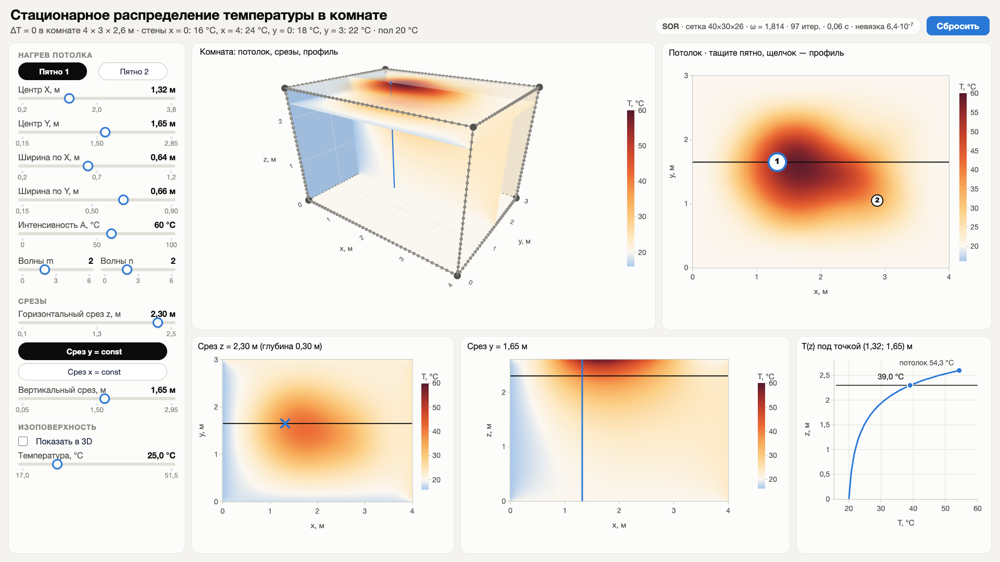
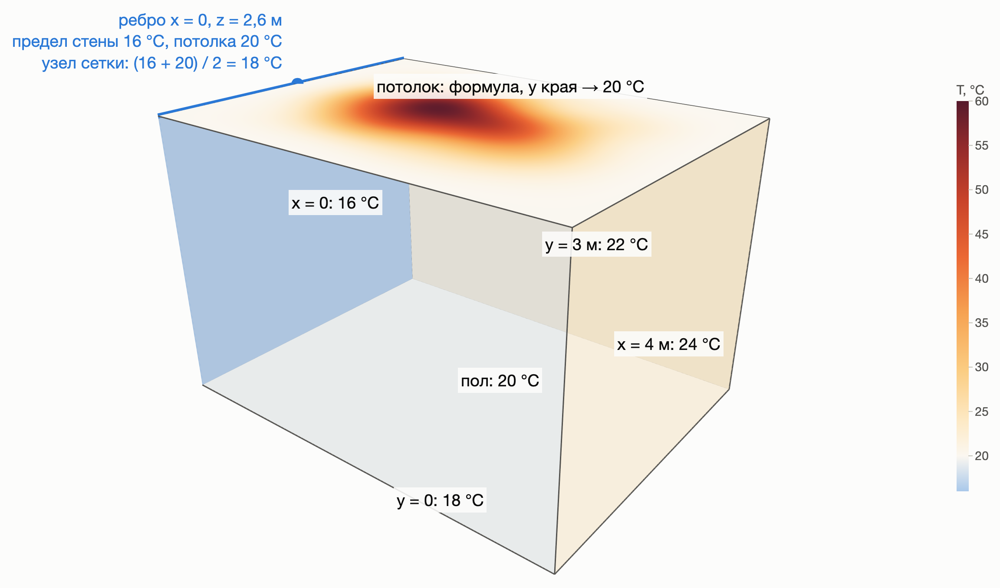
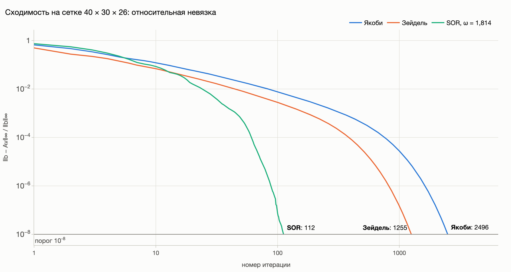
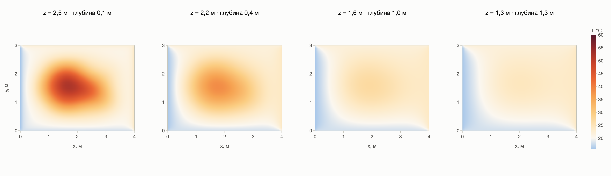
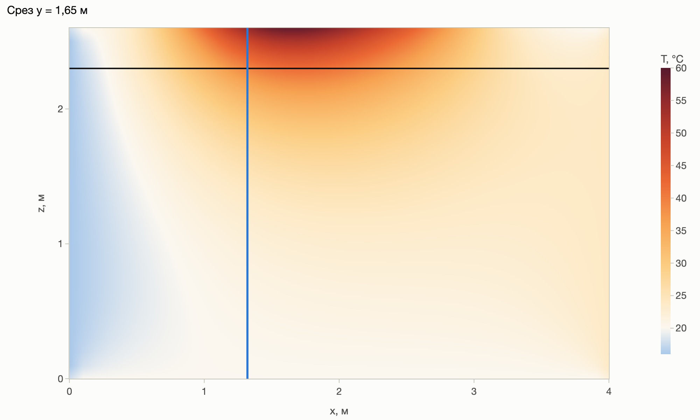
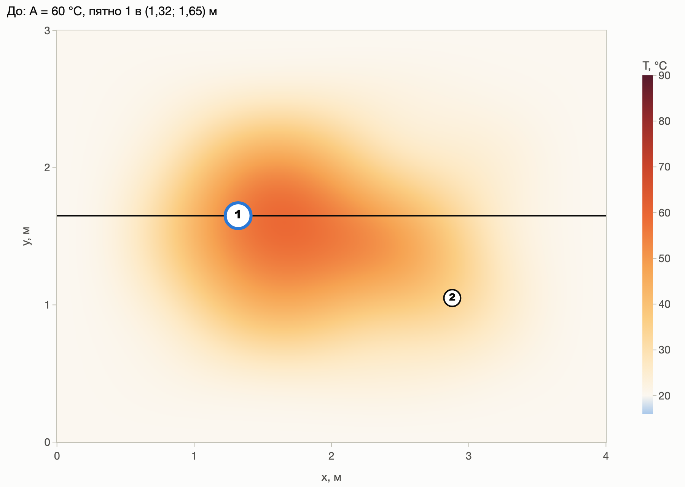
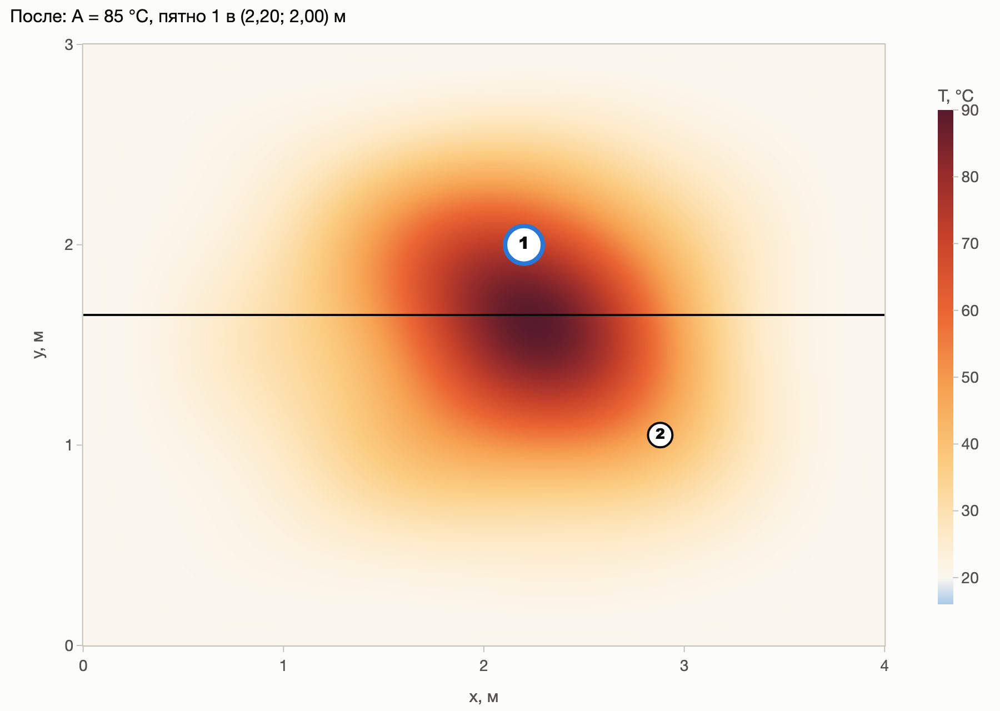

# Стационарное распределение температуры в комнате

[Все задания](../README.md) · Презентация: [PDF](presentation/PDE-Solver.pdf), [PPTX](presentation/PDE-Solver.pptx)

Считаем стационарное поле температуры в комнате 4 × 3 × 2,6 м. Стены и пол держат постоянные
температуры, потолок нагрет двумя пятнами и волновым узором. Задача Дирихле для уравнения
Лапласа решается на сетке схемой «крест» тремя итерационными методами: Якоби, Гаусса — Зейделя
и верхней релаксации (SOR). Стенд на Dash показывает поле в 3D, на срезах и в профиле по высоте.



*Стенд после запуска, окно 1920 × 1080. Справа вверху — итог последнего расчёта SOR.*

## Запуск

macOS и Linux:

```bash
cd PDE-Solver
python3 -m venv .venv
source .venv/bin/activate
pip install -r requirements.txt
python app.py
```

Windows (PowerShell или cmd):

```bat
cd PDE-Solver
py -m venv .venv
.venv\Scripts\activate
pip install -r requirements.txt
python app.py
```

Стенд открывается по адресу <http://127.0.0.1:8050>. Нужен Python 3.9 или новее. Проверено на
Python 3.9.6, numpy 2.0.2, Dash 4.5.0, Plotly 7.1.0. Тесты: `python -m unittest test_heat_room`
(12 тестов, около секунды).

## Постановка

Среда однородная, теплопроводность постоянная, источников нет. Стационарная температура T
удовлетворяет уравнению Лапласа в D = (0; Lx) × (0; Ly) × (0; Lz), Lx = 4 м, Ly = 3 м, Lz = 2,6 м,
с краевыми условиями первого рода T|Γ = φ на границе Γ (задача Дирихле):

```math
\Delta T = \frac{\partial^2 T}{\partial x^2} + \frac{\partial^2 T}{\partial y^2} + \frac{\partial^2 T}{\partial z^2} = 0,\quad (x, y, z) \in D;\qquad T\big|_{\Gamma} = \varphi.
```

| Грань | Условие |
| :--- | :--- |
| стена x = 0 | T(0, y, z) = φ₁ = 16 °C |
| стена x = Lx | T(Lx, y, z) = φ₂ = 24 °C |
| стена y = 0 | T(x, 0, z) = φ₃ = 18 °C |
| стена y = Ly | T(x, Ly, z) = φ₄ = 22 °C |
| пол z = 0 | T(x, y, 0) = φ₅ = 20 °C |
| потолок z = Lz | T(x, y, Lz) = φ₆(x, y) — формула ниже, предел на краю потолка 20 °C |

Потолок в нормированных координатах $`u = x/L_x`$, $`v = y/L_y`$:

```math
\varphi_6(x, y) = 20 + A\,\sin^2(\pi u)\,\sin^2(\pi v)\,\bigl(0,\!12 + 0,\!65\,G_1 + 0,\!30\,G_2 + 0,\!15\,R\bigr),
```

```math
G_j = \exp\!\left(-\tfrac12\left[\left(\frac{u-u_j}{\sigma_{xj}}\right)^2 + \left(\frac{v-v_j}{\sigma_{yj}}\right)^2\right]\right),\qquad
R = \tfrac12\bigl[1 + \sin(2\pi m u)\cos(2\pi n v)\bigr].
```

$`G_1`$, $`G_2`$ — гауссовы пятна, $`R`$ — волновой узор, $`A`$ — интенсивность нагрева.
По умолчанию A = 60 °C, m = n = 2; центры пятен (0,33; 0,55) и (0,72; 0,35), то есть
(1,32; 1,65) и (2,88; 1,05) м, ширины (0,16; 0,22) и (0,13; 0,17). Множитель sin²πu·sin²πv
обращается в нуль на краю потолка, поэтому там T → 20 °C.

**Стыки граней.** На ребре пределы со стороны соседних граней различаются: например, на ребре
стены x = 0 и потолка стена даёт 16 °C, а формула потолка у края стремится к 20 °C. Для
ограниченного гармонического решения внутри значения на рёбрах и в вершинах не нужны. В сеточной
модели принято одно правило для всех 12 рёбер и 8 вершин: узел ребра получает среднее двух
предельных значений примыкающих граней, вершина — среднее трёх. Ребро x = 0, z = 2,6 м:
(16 + 20) / 2 = 18 °C; ребро x = y = 0: (16 + 18) / 2 = 17 °C; вершина (0, 0, 0):
(16 + 18 + 20) / 3 = 18 °C. Значения считаются по маскам граней, порядок заполнения массива на
них не влияет. В 3D-сцене стенда наведите мышь на ребро или вершину: подсказка покажет пределы
граней и значение в узле, взятые из той же таблицы граней, что и в решателе (`heat_room.junctions`).

**Почему стыки не входят в уравнения.** Семиточечный шаблон внутреннего узла (i, j, k) берёт
шесть соседей, у каждого из которых меняется один индекс. Если сосед лежит на границе, крайний
у него ровно один индекс — это узел открытой грани. У узла ребра крайних индексов два, у
вершины — три, поэтому соседями внутренних узлов они не бывают. Они нужны только для рисунков
и интерполяции у стен. Тест подставляет на все рёбра и вершины 1000 °C — решение не меняется.



## Разностная задача и методы

**Сетка.** $`x_m = mh`$, $`y_l = lh`$, $`z_n = nh`$, $`m = 0, \dots, M_x`$, $`l = 0, \dots, M_y`$,
$`n = 0, \dots, M_z`$; h = 0,1 м, Mx = 40, My = 30, Mz = 26. Всего 41 × 31 × 27 = 34 317 узлов;
$`D_h`$ — 39 × 29 × 25 = 28 275 внутренних узлов (неизвестные), $`\Gamma_h`$ — узлы на гранях.

**Схема «крест».** Вторые производные заменяются вторыми разностями на семиточечном шаблоне:

```math
\Lambda_1 T_{mln} + \Lambda_2 T_{mln} + \Lambda_3 T_{mln} = 0,\quad (m, l, n) \in D_h;\qquad
\Lambda_1 T_{mln} = \frac{T_{m-1,l,n} - 2T_{mln} + T_{m+1,l,n}}{h^2},
```

$`\Lambda_2`$, $`\Lambda_3`$ — те же разности по l и n. Условия на $`\Gamma_h`$:
$`T_{0ln} = \varphi_1`$, $`T_{M_x ln} = \varphi_2`$, $`T_{m0n} = \varphi_3`$, $`T_{mM_y n} = \varphi_4`$,
$`T_{ml0} = \varphi_5`$, $`T_{mlM_z} = \varphi_6(x_m, y_l)`$; в узлах рёбер и вершин — правило средних
(см. выше), в уравнения они не входят. Канонический вид при равных шагах — среднее шести соседей:

```math
T_{mln} = \tfrac16\,(T_{m-1,l,n} + T_{m+1,l,n} + T_{m,l-1,n} + T_{m,l+1,n} + T_{m,l,n-1} + T_{m,l,n+1}).
```

**Свойства схемы.**

- Аппроксимация: $`\Lambda T - \Delta T = \frac{h^2}{12}\bigl(T_{xxxx} + T_{yyyy} + T_{zzzz}\bigr) + O(h^4)`$ —
  второй порядок.
- Сеточный принцип максимума: любое решение ΛT = 0 в $`D_h`$ достигает максимума и минимума на
  $`\Gamma_h`$. Отсюда однородная задача имеет только нулевое решение, система однозначно разрешима
  и устойчива по граничным данным: $`\lVert T\rVert_C \le \max_{\Gamma_h}|\varphi|`$.
- Спектр оператора A = −Λ (A = A* > 0):
  $`\lambda_{pqr} = \frac{4}{h^2}\bigl(\sin^2\frac{p\pi}{2M_x} + \sin^2\frac{q\pi}{2M_y} + \sin^2\frac{r\pi}{2M_z}\bigr)`$,
  $`\lambda_{\min} = 3,\!17`$ м⁻², $`\lambda_{\max} = 1196,\!8`$ м⁻², число обусловленности ≈ 378.

**Методы.** Обозначим $`\Sigma^- T = T_{m-1,l,n} + T_{m,l-1,n} + T_{m,l,n-1}`$,
$`\Sigma^+ T = T_{m+1,l,n} + T_{m,l+1,n} + T_{m,l,n+1}`$; i — номер итерации, $`T^{(i+1)} = \varphi`$
на $`\Gamma_h`$, начальное поле $`T^{(0)} = 20`$ °C в $`D_h`$.

| Метод | Итерационное разностное уравнение | Расчётная формула |
| :--- | :--- | :--- |
| Якоби | $`\Sigma^- T^{(i)} + \Sigma^+ T^{(i)} - 6T^{(i+1)}_{mln} = 0`$ | $`T^{(i+1)}_{mln} = \frac16(\Sigma^- T^{(i)} + \Sigma^+ T^{(i)})`$ |
| Зейдель | $`\Sigma^- T^{(i+1)} + \Sigma^+ T^{(i)} - 6T^{(i+1)}_{mln} = 0`$ | $`T^{(i+1)}_{mln} = \frac16(\Sigma^- T^{(i+1)} + \Sigma^+ T^{(i)})`$ |
| Верхняя релаксация | $`LT^{(i+1)} + UT^{(i)} + D\bigl(\frac{T^{(i+1)}}{\tau} + (1 - \frac1\tau)T^{(i)}\bigr) = f`$ | $`T^{(i+1)}_{mln} = (1-\tau)T^{(i)}_{mln} + \frac{\tau}{6}(\Sigma^- T^{(i+1)} + \Sigma^+ T^{(i)})`$ |

L, D, U — нижняя треугольная, диагональная и верхняя треугольная части матрицы системы; 1 < τ < 2,
при τ = 1 — метод Зейделя. Узлы обходятся лексикографически: (1, 1, 1), (1, 1, 2), …
Оптимальный параметр $`\tau = 2/(1 + \sqrt{1 - \rho^2}) = 1,\!814`$, где
$`\rho = 1 - h^2\lambda_{\min}/6 = 0,\!9947`$ — спектральный радиус метода Якоби. В коде параметр
называется `omega` (ω), как в большинстве англоязычных источников. Остановка — по относительной невязке
$`\lVert b - AT^{(i)}\rVert_\infty / \max(1, \lVert b\rVert_\infty) \le \varepsilon`$, где b — вклад граничных значений.

Код написан и для разных шагов по осям: тогда в формулах веса $`h_x^{-2}`$, $`h_y^{-2}`$, $`h_z^{-2}`$
вместо общего множителя 1/6. Для скорости узлы одной плоскости m + l + n = const обновляются одной
операцией numpy: соседи с меньшим индексом лежат на предыдущей плоскости, с большим — на следующей,
а узлы одной плоскости между собой не соседствуют. Результат совпадает с поточечным обходом (тест).

Стенд считает на этой же сетке до невязки 10⁻⁶ и начинает с прошлого поля.

## Сравнение методов



*Одна сетка, один старт (20 °C), один порог невязки 10⁻⁸.*

| Метод | τ | Итераций | Оценка ln(1/ε)/ln(1/ρ) | Отличие от точного сеточного решения, °C |
| :--- | ---: | ---: | ---: | ---: |
| Якоби | — | 2396 | 3477 | 2,1·10⁻⁵ |
| Зейдель | 1 | 1208 | 1738 | 2,1·10⁻⁵ |
| SOR | 1,814 | 109 | 89 | 6,2·10⁻⁷ |

Время счёта — отдельный замер того же прогона `study.py`: медиана трёх запусков на одном
компьютере (macOS 26.7.2, arm64, Apple M5 Pro; Python 3.9.6, numpy 2.0.2). Число итераций от
машины не зависит, время — зависит; среда замера записана в `results.json` (`timing`).

| Метод | Время, с |
| :--- | ---: |
| Якоби | 0,384 |
| Зейдель | 0,645 |
| SOR | 0,070 |

- **По итерациям** SOR выигрывает у Якоби в 22 раза, у Зейделя — в 11 раз; Зейдель у Якоби — в 2,0 раза.
- **По времени** SOR быстрее Якоби в 5,5 раза, Зейделя — в 9,2 раза. Разница с итерациями
  оттого, что проход Якоби — одно векторное выражение, а проход Зейделя или SOR идёт по 91
  плоскости. Итерация Зейделя здесь в 3,3 раза дороже итерации Якоби.
- Подбор τ: 1,5 — 403 итерации, 1,7 — 208, 1,75 — 163, **1,814 — 109**, 1,85 — 128,
  1,9 — 183, 1,95 — 371.
- Оценка по спектральному радиусу описывает самую медленную гармонику ошибки. Для Якоби и
  Зейделя итераций меньше оценки: начальная невязка сосредоточена у потолка и мало проецируется
  на эту гармонику. Для SOR при оптимальном τ матрица перехода имеет жорданову клетку, поэтому
  итераций немного больше оценки.

## Проверка точности

- **Граница.** На каждой открытой грани отклонение от заданных значений 0 °C, рёбра и вершины
  совпадают с правилом средних, итоговая невязка 9,8·10⁻¹¹.
- **Решатель.** Точное решение сеточной системы получено разделением переменных: сумма шести
  задач, в каждой данные только на одной грани, по касательным осям — собственные функции
  sin(pπi/N), по нормали — sinh(μk)/sinh(μN). На сетке 10 × 8 × 7 оно совпадает с независимо
  собранной матрицей и прямым решением до 10⁻¹³ °C (тест).
- **Принцип максимума.** Внутри комнаты 16,47 … 52,13 °C, на границе 16 … 59,04 °C.
- **A = 0.** Потолок равен 20 °C, стены сохраняют свои значения, поле внутри неоднородно:
  16,32 … 23,68 °C, стандартное отклонение 1,50 °C.
- **Сеточная сходимость добавки от нагрева** T(A) − T(0) (те же стены). Её граничные данные
  гладкие и на рёбрах равны нулю. Эталон — ряд Фурье
  $`\sum a_{pq}\sin\frac{p\pi x}{L_x}\sin\frac{q\pi y}{L_y}\frac{\sinh k_{pq}z}{\sinh k_{pq}L_z}`$,
  ошибка — максимум по всем узлам:

  | Шаг h, м | Сетка | Ошибка, °C | Порядок |
  | ---: | :--- | ---: | ---: |
  | 0,2 | 20 × 15 × 13 | 0,192 | — |
  | 0,1 | 40 × 30 × 26 | 0,0523 | 1,88 |
  | 0,05 | 80 × 60 × 52 | 0,0133 | 1,98 |

- **Полное поле вдали от граней.** На рёбрах данные разрывны, и у стыков точность ниже. Поэтому
  разности вложенных сеток меряем в max-норме только в 1200 общих узлах сетки 0,2 м, удалённых от
  всех граней не меньше чем на 0,5 м: 0,124 °C (h = 0,2 и 0,1 м) и 0,0315 °C (0,1 и 0,05 м).
  Порядок по трём сеткам — 1,98. Это оценка внутри области, а не глобальный порядок у рёбер.

## Результаты

### Горизонтальные срезы



*Одно поле при A = 60 °C, общая шкала 16–60 °C.*

| Глубина | Высота z | Внутренние узлы слоя, °C | Слой вместе с узлами на стенах, °C | max T(A) − T(0), °C |
| ---: | ---: | :--- | :--- | ---: |
| 0,1 м | 2,5 м | 18,02 … 52,13 | 16,00 … 52,13 | 32,14 |
| 0,4 м | 2,2 м | 16,85 … 38,46 | 16,00 … 38,46 | 18,56 |
| 1,0 м | 1,6 м | 16,57 … 26,99 | 16,00 … 26,99 | 7,05 |
| 1,3 м | 1,3 м | 16,51 … 24,49 | 16,00 … 24,49 | 4,47 |

Последний столбец — влияние нагрева потолка в целом: разность полей с нагревом и при A = 0 на
внутренних узлах слоя. На глубине 1 м волновой узор почти погас (10 % его амплитуды остаётся уже
на 0,46 м), но нагрев потолка ещё поднимает температуру до 7,05 °C. На глубине 1,3 м максимум
24,49 °C немного выше тёплой стены 24 °C.

### Профиль по высоте

 

Под точкой (1,32; 1,65) м при A = 60 °C: на высоте 2,30 м — 39,0 °C, у потолка — 54,3 °C;
без нагрева на той же высоте — 19,8 °C.

### Затухание неоднородностей с глубиной


Что измерено. Добавка T(A) − T(0) раскладывается по слагаемым формулы: для пятна берём расчёт
только с этим пятном, для волн — разность расчётов с m = n = 2 и с m = n = 0, то есть только
колеблющуюся часть R. Амплитуда на срезе — максимум |компоненты| по узлам слоя. Каждая кривая
нормирована на собственный максимум компоненты на открытой грани потолка. Глубина 10 % —
линейная интерполяция между слоями сетки 0,05 м.

| Компонента | Максимум на потолке | Доля на глубине 0,5 м | Доля на глубине 1,0 м | Глубина 10 % |
| :--- | ---: | ---: | ---: | :--- |
| пятно 1 | 31,7 °C | 32 % | 13 % | 1,16 м (между слоями 1,15 и 1,20) |
| пятно 2 | 10,8 °C | 28 % | 10 % | 1,02 м (между 1,00 и 1,05) |
| волны m = n = 2 | 3,9 °C | 8 % | 1 % | 0,46 м (между 0,45 и 0,50) |

Для отдельной гармоники sin(pπx/Lx)·sin(qπy/Ly) затухание вглубь равно
sinh k(Lz − d) / sinh kLz ≈ exp(−kd). Для волн берём k = 2π√((m/Lx)² + (n/Ly)²) = 5,24 м⁻¹,
и эта оценка даёт 10 % на глубине 0,44 м. Это оценка для одной гармоники: колеблющаяся часть
из-за множителя sin²πu·sin²πv содержит несколько соседних гармоник, а пятна — много низких,
поэтому их кривые одной экспонентой не описываются.

### Выводы

- **Температура с глубиной.** Максимум внутри слоя падает с 52,13 °C на глубине 0,1 м до
  24,49 °C на 1,3 м. В метре под потолком нагрев добавляет не больше 7,05 °C.
- **Мелкий узор гаснет быстрее пятен.** Волны m = n = 2 теряют 90 % амплитуды за 0,46 м,
  пятна — за 1,02 и 1,16 м.
- **Сравнение методов.** SOR с τ = 1,814 сходится за 109 итераций против 1208 у Зейделя и 2396
  у Якоби при пороге 10⁻⁸; по времени — в 5,5 раза быстрее Якоби.

## Сценарий показа стенда

Презентация и показ стенда — отдельные выступления. Порядок действий на стенде:

1. Нажать «Сбросить».
2. Навести мышь на ребро или вершину в 3D-сцене: подсказка показывает пределы граней и значение
   в узле сетки (ребро x = 0, z = 2,6 м — 16 и 20 °C, узел 18 °C).
3. Перетащить маркер пятна 1 на карте потолка в (2,2; 2,0) м. Во время перетаскивания карта
   потолка обновляется сразу, поле пересчитывается после отпускания.
4. Ползунок интенсивности: A = 60 → 85 °C. Общая шкала всех видов становится 16–90 °C.
5. Горизонтальный срез: z = 2,3 → 1,6 м (глубина 1,0 м). Промежуточные высоты интерполируются
   между слоями сетки: например, 1,65 м — глубина 0,95 м.
6. Щёлкнуть по центру маркера пятна 1: профиль T(z) строится под (2,2; 2,0) м,
   на высоте 1,6 м — 30,0 °C, на потолке — 72,6 °C.

| До: A = 60 °C, срез z = 2,3 м | После: A = 85 °C, пятно 1 в (2,2; 2,0) м, срез z = 1,6 м |
| :--- | :--- |
|  |  |
|  |  |

*Обе пары — на одной шкале 16–90 °C. Вертикальный срез остаётся на y = 1,65 м.*

## Учебник

Лобанов А. И., Петров И. Б. Вычислительная математика. Курс лекций. — М.: Физматкнига, 2021. —
476 с. — ISBN 978-5-89155-341-5. [Запись в электронной библиотеке МФТИ](https://books.mipt.ru/book/301568).

Страницы по этому изданию: схема «крест» — §14.1, с. 384–389, сеточный принцип максимума —
лемма 14.3, с. 388; методы Якоби, Зейделя и верхней релаксации для сеточных уравнений — §14.2.5,
с. 402–404; сводка числа итераций — §14.4, с. 409; собственные функции сеточного оператора
Лапласа — §14.7, задачи 2 и 3, с. 416–418; итерационные методы для СЛАУ — §2.5.3, с. 57–61.

## Пересборка материалов

```bash
pip install -r requirements-materials.txt
python study.py          # сравнение методов, проверки, срезы и профиль → results.json, графики
python make_figures.py   # схема, срезы, профиль, пары «до/после» для README
python app.py            # затем в другом окне терминала:
python screenshot.py     # скриншот стенда → figures/app.png
python make_slides.py    # presentation/PDE-Solver.pptx и PDE-Solver.pdf
```

- `make_slides.py` берёт числа из `results.json`, поэтому сначала нужен `study.py`. Время в
  презентации и README — из того же прогона, что и подпись о среде замера.
- `make_slides.py` собирает PPTX и PDF во временной папке. PDF экспортируется через LibreOffice,
  если он установлен, иначе через PowerPoint (Windows — нужен пакет pywin32, macOS — AppleScript).
  Файлы в `presentation/` заменяются только вместе и только после успешного экспорта, число
  страниц PDF сверяется с числом слайдов. Если экспорт не удался, скрипт пишет причину и
  завершается с кодом 1; прежние PPTX и PDF остаются, новый PPTX кладётся в
  `presentation/build/` (папка не попадает в git) — его можно сохранить как PDF вручную.
- `screenshot.py` ищет Chrome, Chromium или Edge сам (Windows, macOS, Linux); другой путь можно
  указать в переменной окружения `CHROME`. Размер окна — аргументы: `python screenshot.py 1366 768`.
- Kaleido 1.x рисует PNG через установленный Chrome и требует Plotly не ниже 6.1.1; если Chrome
  нет, его ставит команда `plotly_get_chrome`.

## Файлы

| Файл | Что внутри |
| :--- | :--- |
| [`heat_room.py`](heat_room.py) | Граничные условия, таблица граней и правило стыков, схема, Якоби, Зейдель, SOR, точные решения для проверок |
| [`app.py`](app.py), [`assets/`](assets/) | Стенд: связанные виды, маркер пятна (`joystick.js`), диапазон осей срезов (`axis_range.js`), стили |
| [`figures.py`](figures.py), [`theme.py`](theme.py) | Рисунки, подсказки рёбер и вершин, общая шкала °C для стенда, отчёта и слайдов |
| [`study.py`](study.py), [`results.json`](results.json) | Сравнение методов и среда замера, проверки, сеточная сходимость, срезы, профиль, затухание |
| [`test_heat_room.py`](test_heat_room.py) | 12 тестов: грани, рёбра и вершины, таблица стыков, порядок обхода, сверка с собранной системой, A = 0, второй порядок |
| [`make_figures.py`](make_figures.py), [`screenshot.py`](screenshot.py), [`make_slides.py`](make_slides.py) | Рисунки README, скриншот стенда, презентация с экспортом PDF |
| [`presentation/`](presentation/) | Презентация: редактируемый PPTX и PDF той же сборки |
