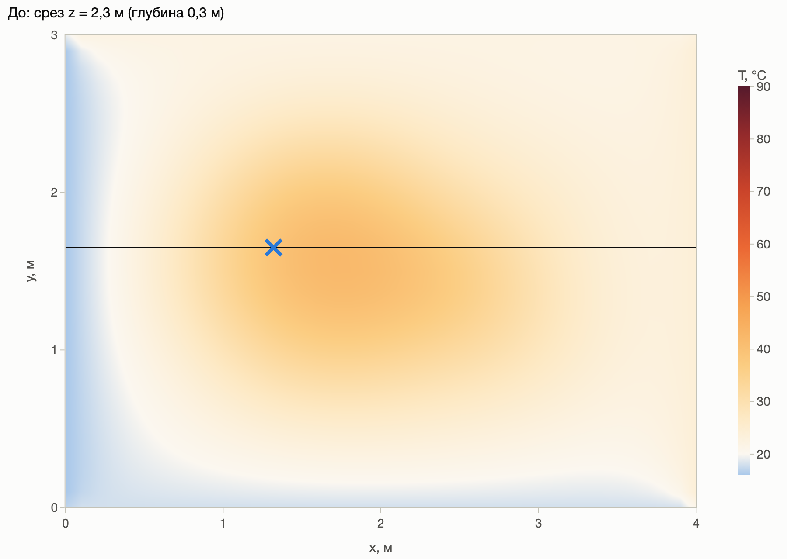
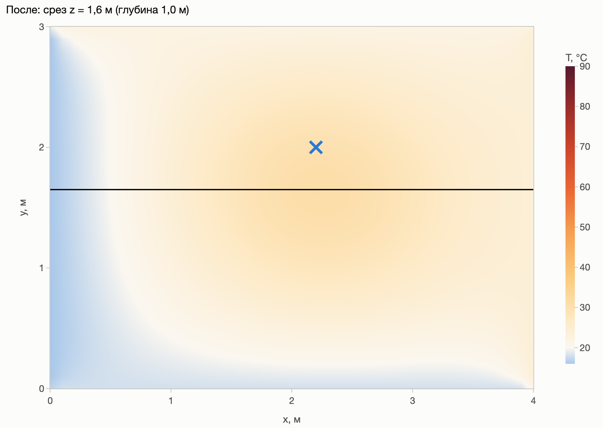

# PDE-Solver — тепло от потолка

[Все задания](../README.md) · Презентация: [PDF](presentation/PDE-Solver.pdf), [PPTX](presentation/PDE-Solver.pptx)

**Как рисунок температуры на потолке меняется с глубиной комнаты?** Считаем стационарное поле
в комнате 4 × 3 × 2,6 м. Стены и пол держат постоянные температуры, на потолке задан нагрев
двумя пятнами и волнами. Поле находится методом верхней релаксации (SOR); стенд на Dash
показывает его в 3D, на срезах и в профиле по высоте.


*Стенд после запуска, окно 1920 × 1080. Справа вверху — итог последнего расчёта SOR.*

## Запуск

macOS и Linux:

```bash
cd PDE-Solver
python3 -m venv .venv
source .venv/bin/activate
pip install -r requirements.txt
python app.py
```

Windows (PowerShell или cmd):

```bat
cd PDE-Solver
py -m venv .venv
.venv\Scripts\activate
pip install -r requirements.txt
python app.py
```

Стенд открывается по адресу <http://127.0.0.1:8050>. Нужен Python 3.9 или новее. Проверено на
Python 3.9.6, numpy 2.0.2, Dash 4.5.0, Plotly 7.1.0. Тесты: `python -m unittest test_heat_room`
(11 тестов, около секунды).

## Постановка

Область — параллелепипед [0; 4] × [0; 3] × [0; 2,6] м. Среда однородная, теплопроводность
постоянная, источников нет, поэтому внутри ΔT = 0. Данные Дирихле заданы на открытых гранях:

| Грань | Температура |
| :--- | :--- |
| стена x = 0 | 16 °C |
| стена x = 4 м | 24 °C |
| стена y = 0 | 18 °C |
| стена y = 3 м | 22 °C |
| пол z = 0 | 20 °C |
| потолок z = 2,6 м | формула ниже, предел на краю потолка — 20 °C |

Потолок в нормированных координатах $`u = x/L_x`$, $`v = y/L_y`$:

```math
T_{\text{пот}} = 20 + A\,\sin^2(\pi u)\,\sin^2(\pi v)\,\bigl(0,\!12 + 0,\!65\,G_1 + 0,\!30\,G_2 + 0,\!15\,R\bigr),
```

```math
G_j = \exp\!\left(-\tfrac12\left[\left(\frac{u-u_j}{\sigma_{xj}}\right)^2 + \left(\frac{v-v_j}{\sigma_{yj}}\right)^2\right]\right),\qquad
R = \tfrac12\bigl[1 + \sin(2\pi m u)\cos(2\pi n v)\bigr].
```

По умолчанию A = 60 °C, m = n = 2; центры пятен (0,33; 0,55) и (0,72; 0,35), ширины
(0,16; 0,22) и (0,13; 0,17). Множитель sin²πu·sin²πv обращается в нуль на краю потолка,
поэтому там T → 20 °C.

**Стыки граней.** На ребре пределы со стороны соседних граней различаются: например, на ребре
x = y = 0 это 16 и 18 °C. Для ограниченного гармонического решения внутри значения на рёбрах
и в вершинах не нужны. В сеточной модели принято одно правило для всех 12 рёбер и 8 вершин:
внутренний узел ребра получает среднее двух предельных значений примыкающих граней, вершина —
среднее трёх. Ребро x = y = 0 между полом и потолком: (16 + 18) / 2 = 17 °C; ребро x = 0 у
потолка: (16 + 20) / 2 = 18 °C; вершина (0, 0, 0): (16 + 18 + 20) / 3 = 18 °C. Значения
считаются по маскам граней, порядок заполнения массива на них не влияет.

**Почему стыки не входят в уравнения.** Семиточечный шаблон внутреннего узла (i, j, k) берёт
шесть соседей, у каждого из которых меняется один индекс. Если сосед лежит на границе, крайний
у него ровно один индекс — это узел открытой грани. У узла ребра крайних индексов два, у
вершины — три, поэтому соседями внутренних узлов они не бывают. Они нужны только для рисунков
и интерполяции у стен. Тест подставляет на все рёбра и вершины 1000 °C — решение не меняется.


## Схема и методы

Сетка 40 × 30 × 26 шагов (h = 0,1 м), 28 275 неизвестных. Схема «крест» второго порядка с
шагами по трём осям:

```math
\frac{T_{i-1,j,k} - 2T_{ijk} + T_{i+1,j,k}}{h_x^2} + \frac{T_{i,j-1,k} - 2T_{ijk} + T_{i,j+1,k}}{h_y^2}
+ \frac{T_{i,j,k-1} - 2T_{ijk} + T_{i,j,k+1}}{h_z^2} = 0.
```

Итерация SOR пересчитывает внутренний узел через уже обновлённых соседей с меньшим индексом
и прежние значения соседей с большим; $`c_x = h_x^{-2}`$, $`c_y = h_y^{-2}`$, $`c_z = h_z^{-2}`$:

```math
T^{s+1}_{ijk} = (1-\omega)\,T^{s}_{ijk} + \omega\,
\frac{c_x(T^{s+1}_{i-1,j,k} + T^{s}_{i+1,j,k}) + c_y(T^{s+1}_{i,j-1,k} + T^{s}_{i,j+1,k}) + c_z(T^{s+1}_{i,j,k-1} + T^{s}_{i,j,k+1})}{2(c_x + c_y + c_z)}.
```

При ω = 1 это метод Зейделя; метод Якоби берёт всех соседей с прошлой итерации. Параметр
$`\omega_{\text{опт}} = 2/(1 + \sqrt{1 - \rho_J^2}) = 1,\!814`$, где
$`\rho_J = (c_x\cos\frac{\pi}{N_x} + c_y\cos\frac{\pi}{N_y} + c_z\cos\frac{\pi}{N_z})/(c_x + c_y + c_z) = 0,\!9947`$ —
спектральный радиус метода Якоби. Остановка — по относительной невязке
$`\lVert b - Av\rVert_\infty / \max(1, \lVert b\rVert_\infty)`$; старт — 20 °C во всех внутренних узлах.

Обход узлов лексикографический, как в учебнике. Для скорости узлы одной плоскости
i + j + k = const обновляются одной операцией numpy: соседи с меньшим индексом лежат на
предыдущей плоскости, с большим — на следующей, а узлы одной плоскости между собой не
соседствуют. Тест сравнивает такой проход с поточечным циклом.

Стенд считает на этой же сетке до невязки 10⁻⁶ и начинает с прошлого поля.

## Сравнение методов


*Одна сетка, один старт (20 °C), один порог невязки 10⁻⁸.*

| Метод | ω | Итераций | Оценка ln(1/ε)/ln(1/ρ) | Время, с | Отличие от точного сеточного решения, °C |
| :--- | ---: | ---: | ---: | ---: | ---: |
| Якоби | 1 | 2396 | 3477 | 0,40 | 2,1·10⁻⁵ |
| Зейдель | 1 | 1208 | 1738 | 0,66 | 2,1·10⁻⁵ |
| SOR | 1,814 | 109 | 89 | 0,07 | 6,2·10⁻⁷ |

Время — медиана трёх запусков на Apple M5 Pro, macOS 26.7, Python 3.9.6, numpy 2.0.2, без
параллельных процессов. Число итераций от машины не зависит.

- **По итерациям** SOR выигрывает у Якоби в 22 раза, у Зейделя — в 11 раз; Зейдель у Якоби — в 2,0 раза.
- **По времени** SOR быстрее Якоби в 5,7 раза, Зейделя — в 9,4 раза. Разница с итерациями
  оттого, что проход Якоби — одно векторное выражение, а проход Зейделя или SOR идёт по 91
  плоскости. Итерация Зейделя здесь в 3,3 раза дороже итерации Якоби.
- Подбор ω: 1,5 — 403 итерации, 1,7 — 208, 1,75 — 163, **1,814 — 109**, 1,85 — 128,
  1,9 — 183, 1,95 — 371.
- Оценка по спектральному радиусу описывает самую медленную гармонику ошибки. Для Якоби и
  Зейделя итераций меньше оценки: начальная невязка сосредоточена у потолка и мало проецируется
  на эту гармонику. Для SOR при оптимальном ω матрица перехода имеет жорданову клетку, поэтому
  итераций немного больше оценки.

## Проверка точности

- **Граница.** На каждой открытой грани отклонение от заданных значений 0 °C, рёбра и вершины
  совпадают с правилом средних, итоговая невязка 9,8·10⁻¹¹.
- **Решатель.** Точное решение сеточной системы получено разделением переменных: сумма шести
  задач, в каждой данные только на одной грани, по касательным осям — собственные функции
  sin(pπi/N), по нормали — sinh(μk)/sinh(μN). На сетке 10 × 8 × 7 оно совпадает с независимо
  собранной матрицей и прямым решением до 10⁻¹³ °C (тест).
- **Принцип максимума.** Внутри комнаты 16,47 … 52,13 °C, на границе 16 … 59,04 °C.
- **A = 0.** Потолок равен 20 °C, стены сохраняют свои значения, поле внутри неоднородно:
  16,32 … 23,68 °C, стандартное отклонение 1,50 °C.
- **Сеточная сходимость добавки к фону** (нагрев минус расчёт при A = 0, те же стены). Её
  граничные данные гладкие и на стыках равны нулю. Эталон — ряд Фурье
  $`\sum a_{pq}\sin\frac{p\pi x}{L_x}\sin\frac{q\pi y}{L_y}\frac{\sinh k_{pq}z}{\sinh k_{pq}L_z}`$,
  ошибка — максимум по всем узлам:

  | Шаг h, м | Сетка | Ошибка, °C | Порядок |
  | ---: | :--- | ---: | ---: |
  | 0,2 | 20 × 15 × 13 | 0,192 | — |
  | 0,1 | 40 × 30 × 26 | 0,0523 | 1,88 |
  | 0,05 | 80 × 60 × 52 | 0,0133 | 1,98 |

- **Полное поле.** На рёбрах данные скачут, и у стыков точность ниже. Поэтому разности
  вложенных сеток меряем в max-норме только в 1200 узлах сетки 0,2 м, удалённых от всех граней
  не меньше чем на 0,5 м: 0,124 °C (h = 0,2 и 0,1 м) и 0,0315 °C (0,1 и 0,05 м). Порядок по
  трём сеткам — 1,98.

## Как рисунок меняется с глубиной


*Срезы на одной шкале 16–60 °C. Под потолком видны пятно 1 и «плечо» пятна 2; на глубине
0,8 м остаётся тёплое пятно до 29,5 °C; на 1,3 м поле в пределах 16,5–24,5 °C и определяется
в основном стенами.*


Что измерено. Добавка к фону — T при заданном нагреве минус T при A = 0 с теми же стенами.
Она раскладывается по слагаемым формулы: для пятна берём расчёт только с этим пятном, для волн —
разность расчётов с m = n = 2 и с m = n = 0, то есть только осциллирующую часть R. Амплитуда
на срезе — максимум |компоненты| по узлам слоя. Нормировка — тот же максимум на открытой грани
потолка. Глубина 10 % — линейная интерполяция между слоями сетки 0,05 м.

| Компонента | Амплитуда на потолке | Доля на глубине 0,5 м | Доля на глубине 1,0 м | Глубина 10 % |
| :--- | ---: | ---: | ---: | :--- |
| пятно 1 | 31,7 °C | 32 % | 13 % | 1,16 м (между слоями 1,15 и 1,20) |
| пятно 2 | 10,8 °C | 28 % | 10 % | 1,02 м (между 1,00 и 1,05) |
| волны m = n = 2 | 3,9 °C | 8 % | 1 % | 0,46 м (между 0,45 и 0,50) |

Для отдельной гармоники sin(pπx/Lx)·sin(qπy/Ly) затухание вглубь равно
sinh k(Lz − d) / sinh kLz ≈ exp(−kd). Для волн берём k = 2π√((m/Lx)² + (n/Ly)²) = 5,24 м⁻¹,
и эта оценка даёт 10 % на глубине 0,44 м. Это оценка для одной гармоники; осциллирующая часть
из-за множителя sin²πu·sin²πv содержит несколько соседних гармоник, а пятна — много низких,
поэтому их кривые одной экспонентой не описываются.

**Вывод.** Чем мельче деталь нагрева, тем ближе к потолку она гаснет. Волновой узор с периодом
2 × 1,5 м теряет 90 % амплитуды за 0,46 м, пятна шириной около 0,5–0,7 м — за 1,0–1,2 м.
В метре под потолком от узора остаётся 1 %, от пятен — 10–13 %; ниже поле определяют
в основном температуры стен.

## Живой показ

1. Нажать «Сбросить».
2. Перетащить маркер пятна 1 на карте потолка в (2,2; 2,0) м.
3. Ползунок интенсивности: A = 60 → 85 °C. Общая шкала всех видов становится 16–90 °C.
4. Горизонтальный срез: z = 2,3 → 1,6 м (глубина 1,0 м).
5. Щёлкнуть по центру маркера пятна 1: профиль T(z) строится под (2,2; 2,0) м,
   на высоте 1,6 м — 30,0 °C, на потолке — 72,6 °C.

| До: A = 60 °C, срез z = 2,3 м | После: A = 85 °C, пятно 1 в (2,2; 2,0) м, срез z = 1,6 м |
| :--- | :--- |
|  |  |
|  |  |

*Обе пары — на одной шкале 16–90 °C. Вертикальный срез остаётся на y = 1,65 м.*

## Учебник

Лобанов А. И., Петров И. Б. Вычислительная математика. Курс лекций. — М.: Физматкнига, 2021. —
476 с. — ISBN 978-5-89155-341-5. [Запись в электронной библиотеке МФТИ](https://books.mipt.ru/book/301568).

Страницы по этому изданию: схема «крест» — §14.1, с. 384–389, сеточный принцип максимума —
лемма 14.3, с. 388; методы Якоби, Зейделя и верхней релаксации для сеточных уравнений — §14.2.5,
с. 402–404; сводка числа итераций — §14.4, с. 409; собственные функции сеточного оператора
Лапласа — §14.7, задачи 2 и 3, с. 416–418; итерационные методы для СЛАУ — §2.5.3, с. 57–61.

## Пересборка материалов

```bash
pip install -r requirements-materials.txt
python study.py          # сравнение методов и проверки → results.json, графики
python make_figures.py   # рисунки видов, схема, пары «до/после»
python app.py            # затем в другом окне терминала:
python screenshot.py     # скриншот стенда → figures/app.png
python make_slides.py    # presentation/PDE-Solver.pptx и PDF
```

- `screenshot.py` ищет Chrome, Chromium или Edge сам (Windows, macOS, Linux); другой путь можно
  указать в переменной окружения `CHROME`. Размер окна — аргументы: `python screenshot.py 1366 768`.
- `make_slides.py` после PPTX сам экспортирует PDF: через LibreOffice, если он установлен, иначе
  через PowerPoint (Windows — нужен пакет pywin32, macOS — AppleScript). Если нет ни того ни
  другого, откройте PPTX и сохраните как PDF вручную.
- Kaleido 1.x рисует PNG через установленный Chrome; если Chrome нет, его ставит команда
  `plotly_get_chrome`.

## Файлы

| Файл | Что внутри |
| :--- | :--- |
| [`heat_room.py`](heat_room.py) | Граничные условия и правило стыков, схема, Якоби, Зейдель, SOR, точные решения для проверок |
| [`app.py`](app.py), [`assets/`](assets/) | Стенд: связанные виды, маркер пятна (`joystick.js`), диапазон осей срезов (`axis_range.js`), стили |
| [`figures.py`](figures.py), [`theme.py`](theme.py) | Рисунки и общая шкала °C для стенда, отчёта и слайдов |
| [`study.py`](study.py), [`results.json`](results.json) | Сравнение методов, проверки, сеточная сходимость, затухание с глубиной |
| [`test_heat_room.py`](test_heat_room.py) | 11 тестов: грани, рёбра и вершины, порядок обхода, сверка с собранной системой, A = 0, второй порядок |
| [`make_figures.py`](make_figures.py), [`screenshot.py`](screenshot.py), [`make_slides.py`](make_slides.py) | Рисунки, скриншот стенда, презентация |
