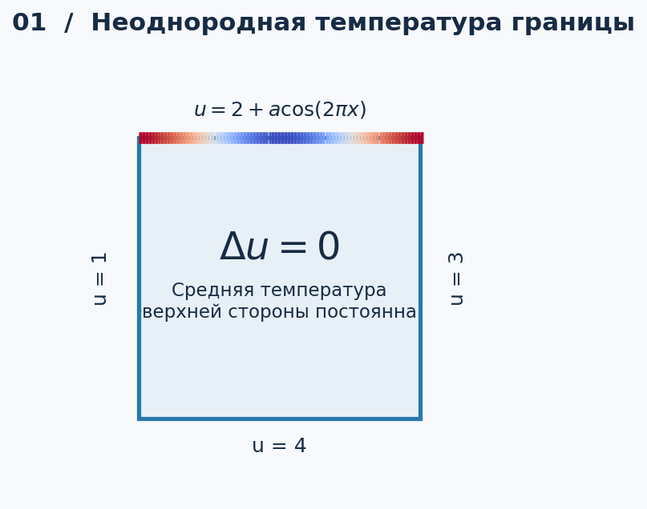
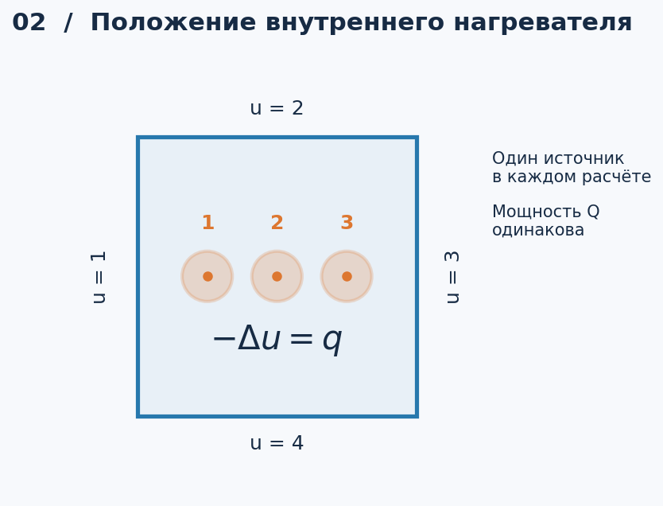
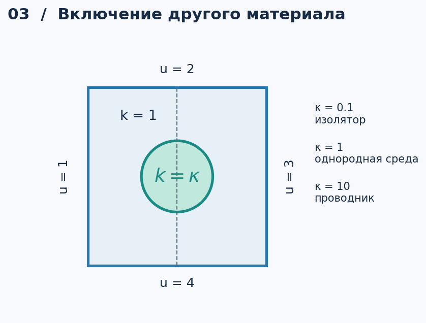
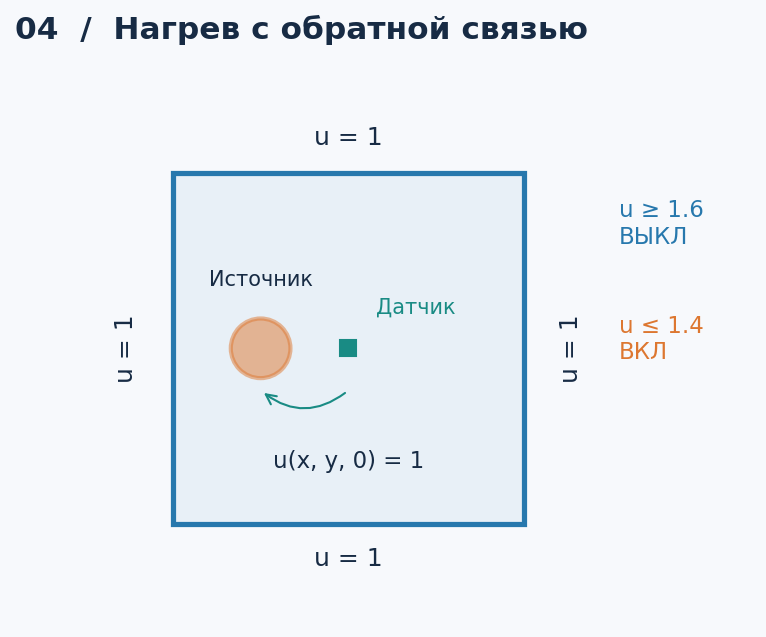

# PDE-Solver

[Все задания](../README.md)

Численное исследование двумерной теплопроводности. Ниже приведены четыре варианта проекта на основе задачи № 16: каждый добавляет отдельный исследовательский вопрос к сравнению методов Якоби, Зейделя и верхней релаксации (SOR).

## Исходная задача

Квадратное сечение балки со стороной $`L=0.1`$ м. После нормировки координат на $`L`$ область имеет вид $`\Omega=(0,1)^2`$, температура $`u=T/T_*`$, $`T_*=100\,^{\circ}\mathrm{C}`$.

```math
\Delta u=0,\qquad
u(0,y)=1,\quad u(x,1)=2,\quad u(1,y)=3,\quad u(x,0)=4.
```

Это контрольная постановка для вариантов 1–3. Вариант 4 использует отдельные начальные и граничные условия. Все дополнительные параметры ниже безразмерны. Иллюстрации показывают условия задач, а не результаты численного решения.

## Варианты проекта

| Вариант | Тема доклада | Сложность | Основное отличие |
| --- | --- | --- | --- |
| 1 | Влияние неоднородного нагрева границы | Базовая | Меняется только граничное условие |
| 2 | Влияние положения внутреннего нагревателя | Средняя | Уравнение Пуассона, источник фиксированной мощности |
| 3 | Теплопроводящее и теплоизолирующее включение | Повышенная | Два материала, скачок теплопроводности |
| 4 | Нагрев с обратной связью: модель термостата | Высокая | Зависимость от времени и переключение нагревателя |

### 1. Неравномерный нагрев границы

**Вопрос:** как распределение температуры на одной стороне влияет на внутреннее поле при неизменной средней температуре этой стороны?



Уравнение и три стороны сохраняются из исходной задачи. На верхней стороне:

```math
u(x,1)=2+a\cos(2\pi x),\qquad a\in\{0,0.5,1\}.
```

Среднее значение на стороне равно 2 для всех $`a`$. Это сравнение при одинаковой средней температуре, а не при одинаковой мощности нагрева.

**Эксперимент:** сравнить поле с исходным решением $`u_0`$; построить $`u-u_0`$, вертикальное сечение $`u(0.5,y)`$ и зависимость температуры в центре от $`a`$.

**Для доклада:** показать, насколько глубоко в область распространяется неоднородность граничного нагрева. Расширение: заменить $`\cos(2\pi x)`$ на $`\cos(2\pi m x)`$ и сравнить $`m=1,2,4`$.

### 2. Расположение внутреннего нагревателя

**Вопрос:** как положение нагревателя влияет на локальный перегрев при одинаковой суммарной мощности?



Граничные условия сохраняются из исходной задачи:

```math
-\Delta u=q(x,y),\qquad
q(x,y)=\frac{Q}{Z}\exp\!\left(-\frac{(x-x_c)^2+(y-y_c)^2}{2\sigma^2}\right),
```

где $`Z`$ — интеграл экспоненты по $`\Omega`$, поэтому $`\int_\Omega q\,d\Omega=Q`$. На сетке нормировка выполняется по дискретной сумме.

**Параметры:** $`Q=10`$, $`\sigma=0.08`$, $`y_c=0.5`$, $`x_c\in\{0.25,0.5,0.75\}`$.

**Эксперимент:** определить максимум температуры внутри области и его координаты; построить добавочный нагрев $`w=u-u_0`$ и сравнить $`\max_\Omega w`$. Источники включаются по одному.

**Для доклада:** отделить влияние положения источника от влияния неодинаковых температур сторон. Расширение: подобрать положение, минимизирующее максимальную внутреннюю температуру, при $`x_c,y_c\in[0.2,0.8]`$.

### 3. Включение другого материала

**Вопрос:** как проводящая или изолирующая вставка перераспределяет тепло внутри балки?



Граничные условия сохраняются из исходной задачи:

```math
-\nabla\cdot(k\nabla u)=0.
```

| Область | Теплопроводность |
| --- | --- |
| $`(x-0.5)^2+(y-0.5)^2 \lt r^2`$ | $`k(x,y)=\kappa`$ |
| Остальная часть квадрата | $`k(x,y)=1`$ |

**Параметры:** $`r=0.2`$, $`\kappa\in\{0.1,1,10\}`$. На границе материалов непрерывны температура и нормальная составляющая теплового потока. Дискретизация — консервативная, с согласованным потоком через грани ячеек.

**Эксперимент:** сравнить изолинии, сечение $`u(x,0.5)`$, поле потока $`\mathbf j=-k\nabla u`$ вблизи вставки и перенос тепла через центральное сечение:

```math
J=\int_0^1 j_x(0.5,y)\,dy.
```

**Для доклада:** сопоставить изгиб изотерм и перераспределение потока для трёх контрастов материала. Отдельно оценить, как контраст $`k`$ влияет на число итераций и выбор параметра SOR.

**Рекомендуемый вариант:** наглядное физическое отличие от исходной задачи при сохранении стационарной постановки и сравнения трёх итерационных методов.

### 4. Нагреватель с термостатом

**Вопрос:** как положение датчика и ширина порогового интервала влияют на перегрев и частоту включений?



```math
\frac{\partial u}{\partial t}=\Delta u+s(t)q(x,y),\qquad
u|_{\partial\Omega}=1,\qquad u(x,y,0)=1,\qquad 0\leq t\leq1.
```

Источник $`q`$ задаётся как в варианте 2: $`Q=10`$, $`\sigma=0.08`$, центр $`(0.25,0.5)`$. Начальное состояние нагревателя $`s(0)=1`$. При температуре датчика $`u_s`$:

- $`u_s\geq1.6`$ — выключение ($`s=0`$);
- $`u_s\leq1.4`$ — включение ($`s=1`$);
- между порогами сохраняется предыдущее состояние.

**Эксперимент:** сравнить датчик в точках $`(0.5,0.5)`$ и $`(0.75,0.5)`$; затем изменить пороговый интервал с $`[1.4,1.6]`$ на $`[1.45,1.55]`$. Построить $`u_s(t)`$, максимальную температуру, состояние $`s(t)`$ и несколько снимков поля. Измерить число переключений и суммарное время работы нагревателя.

**Для доклада:** показать различие между температурой датчика и максимальной температурой в области. Расчёт — неявная схема по времени; на каждом шаге решается линейная система. Устойчивость выводов проверяется уменьшением шага времени.

## Общая численная часть

- Сетки: $`N=20,40,80,160`$ разбиений на сторону. Для вариантов 1–3 — сравнение Якоби, Зейделя и SOR по числу итераций, времени и невязке при одинаковом допуске. Для варианта 4 — сравнение решателей на временном шаге и проверка сходимости по времени.
- Остановка: $`\|b-Av\|_\infty/\max(1,\|b\|_\infty)\leq10^{-10}`$; подбор параметра SOR в $`1\leq\omega\lt 2`$.
- Проверки: совпадение решений разных методов, сгущение сетки, контрольное решение небольшой системы прямым методом. В варианте 3 при $`\kappa=1`$ должна восстанавливаться исходная задача.
- В вариантах 1–3 граничные температуры имеют разрывы в углах. Для отрисовки углам присваивается полусумма соседних значений; оценка точности и градиентов проводится также в фиксированной области вдали от углов.

**Материалы доклада:** постановка и исследовательский вопрос; схема условий; 3–4 сопоставимых графика; таблица сходимости; вывод о влиянии выбранного параметра. Для проекта достаточно одного варианта с контрольным расчётом исходной задачи там, где он применим.
