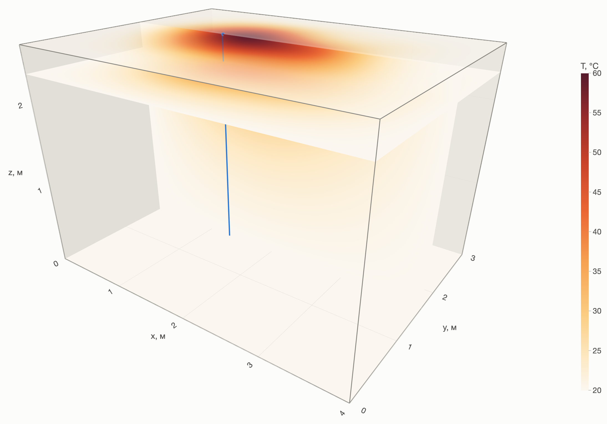
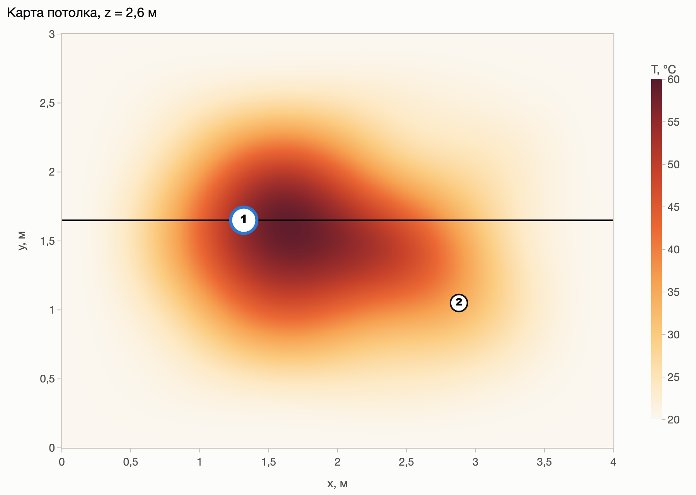
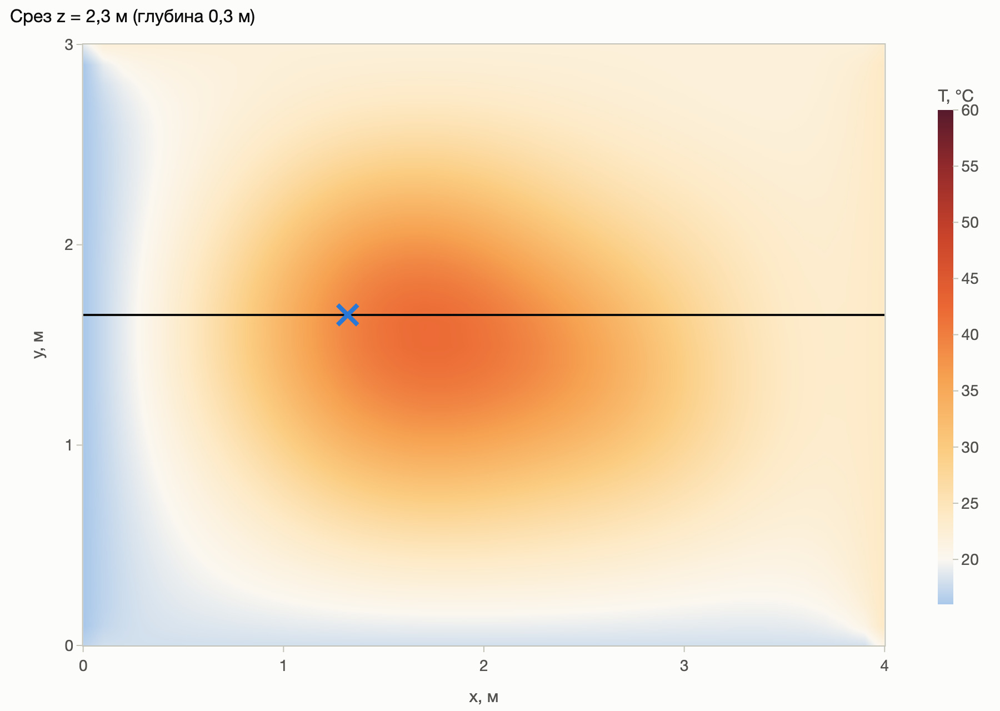
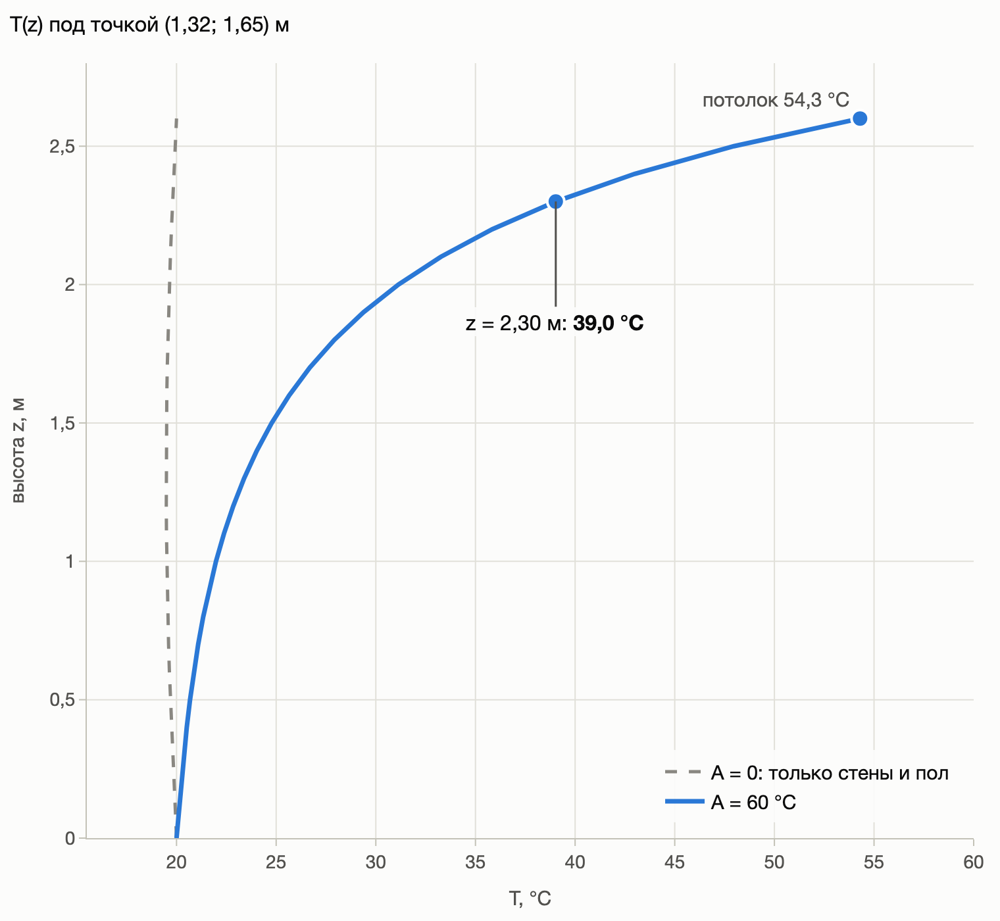
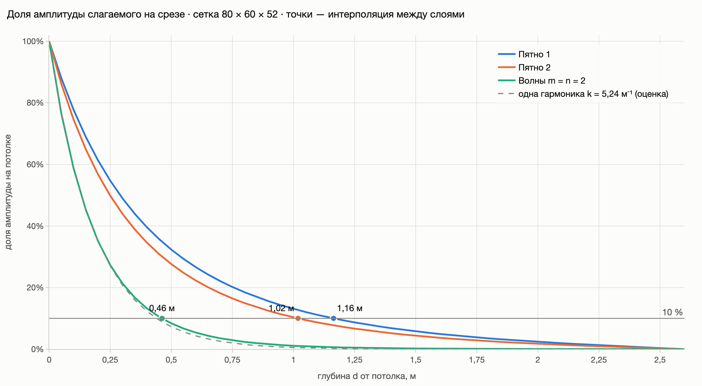
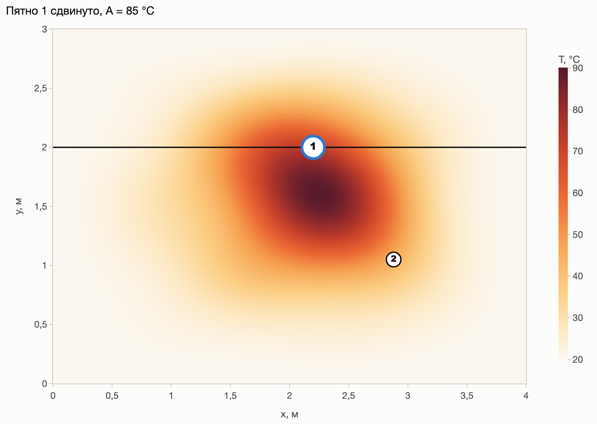
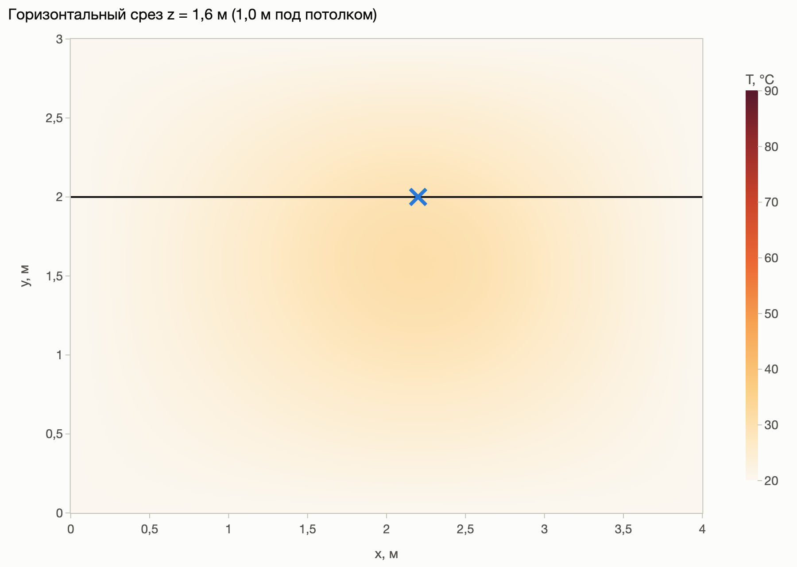

# PDE-Solver — тепло от потолка

[Все задания](../README.md) · [Презентация (PDF)](presentation/PDE-Solver.pdf) · [Презентация (PPTX)](presentation/PDE-Solver.pptx)

**Как рисунок температуры на потолке меняется с глубиной?** Комната 4 × 3 × 2,6 м, пол и четыре
стены держат 20 °C, на потолке — два горячих пятна и волновой узор. Внутри решается уравнение
Лапласа ΔT = 0. Поле считается методом верхней релаксации (SOR), а интерактивный стенд показывает
одну и ту же комнату в четырёх связанных видах на общей шкале °C.


*Стенд при исходных настройках. Слева — панель управления, в центре — 3D-комната с полупрозрачным
потолком и срезами, справа — карта потолка: маркер «1» перетаскивается как джойстик. Внизу —
горизонтальный срез z = 2,3 м, вертикальный срез y = 1,65 м и профиль T(z) под центром пятна 1.
Справа вверху — сводка последнего расчёта SOR.*

## Запуск

```bash
cd PDE-Solver
python3 -m venv .venv
source .venv/bin/activate
pip install -r requirements.txt
python app.py
```

Откройте <http://127.0.0.1:8050>. На Windows вместо `source .venv/bin/activate` выполните
`.venv\Scripts\activate`. Нужен Python 3.9 или новее; первое поле считается за доли секунды.

Проверки и пересборка материалов:

```bash
python -m unittest test_heat_room          # 6 тестов решателя, около 1 с
pip install -r requirements-materials.txt  # kaleido, matplotlib, python-pptx
python study.py                            # сравнение методов и проверки → results.json, графики
python make_figures.py                     # рисунки представлений для отчёта и слайдов
python make_slides.py                      # presentation/PDE-Solver.pptx
```

## Задача


Область — параллелепипед $`[0, 4] \times [0, 3] \times [0, 2{,}6]`$ м. Внутри

```math
\frac{\partial^2 T}{\partial x^2} + \frac{\partial^2 T}{\partial y^2} + \frac{\partial^2 T}{\partial z^2} = 0,
```

на полу и стенах $`T = 20`$ °C, на потолке в нормированных координатах $`u = x/L_x`$, $`v = y/L_y`$

```math
T_{\text{пот}} = 20 + A\,\sin^2(\pi u)\,\sin^2(\pi v)\,\bigl(0{,}12 + 0{,}65\,G_1 + 0{,}30\,G_2 + 0{,}15\,R\bigr),
```

```math
G_j = \exp\!\left(-\tfrac12\left[\left(\frac{u-u_j}{\sigma_{xj}}\right)^2 + \left(\frac{v-v_j}{\sigma_{yj}}\right)^2\right]\right),\qquad
R = \tfrac12\bigl[1 + \sin(2\pi m u)\cos(2\pi n v)\bigr].
```

По умолчанию $`A = 60`$ °C, $`m = n = 2`$, центры пятен $`(0{,}33;\ 0{,}55)`$ и $`(0{,}72;\ 0{,}35)`$,
ширины $`(0{,}16;\ 0{,}22)`$ и $`(0{,}13;\ 0{,}17)`$. Множитель $`\sin^2\pi u\,\sin^2\pi v`$ сводит
потолок к 20 °C у стен, поэтому граничные данные непрерывны и решение не имеет скачков на рёбрах.
Максимум потолка при этих настройках — 59,0 °C.

<br clear="right">

## Численный метод

Теория — лекции 2 и 14 курса А. И. Лобанова и И. Б. Петрова «Вычислительная математика».

**Схема.** Равномерная сетка с шагами $`h_x, h_y, h_z`$; семиточечный «крест» второго порядка:

```math
\frac{T_{i-1,j,k} - 2T_{ijk} + T_{i+1,j,k}}{h_x^2} + \frac{T_{i,j-1,k} - 2T_{ijk} + T_{i,j+1,k}}{h_y^2}
+ \frac{T_{i,j,k-1} - 2T_{ijk} + T_{i,j,k+1}}{h_z^2} = 0.
```

**Итерации.** С $`c_x = h_x^{-2}`$, $`c_y = h_y^{-2}`$, $`c_z = h_z^{-2}`$ одна итерация SOR (формула П2.38
учебника в трёх измерениях):

```math
T^{s+1}_{ijk} = (1-\omega)\,T^{s}_{ijk} + \omega\,
\frac{c_x\,(T^{s+1}_{i-1,j,k} + T^{s}_{i+1,j,k}) + c_y\,(T^{s+1}_{i,j-1,k} + T^{s}_{i,j+1,k}) + c_z\,(T^{s+1}_{i,j,k-1} + T^{s}_{i,j,k+1})}{2\,(c_x + c_y + c_z)}.
```

При $`\omega = 1`$ это метод Зейделя, а метод Якоби берёт все соседние значения с прошлой итерации.
Оптимальный параметр — по теореме Янга через спектральный радиус метода Якоби:

```math
\rho_J = \frac{c_x\cos\frac{\pi}{N_x} + c_y\cos\frac{\pi}{N_y} + c_z\cos\frac{\pi}{N_z}}{c_x + c_y + c_z},\qquad
\omega_{\text{опт}} = \frac{2}{1 + \sqrt{1 - \rho_J^2}}.
```

**Реализация.** Узлы обходятся в лексикографическом порядке, как в учебнике. Для скорости узлы одной
плоскости $`i + j + k = \text{const}`$ обновляются одной операцией numpy: их соседи лежат на
соседних плоскостях, поэтому результат совпадает с поточечным обходом (это проверяет тест).
Остановка — по относительной невязке $`\lVert b - Av\rVert_\infty / \max(1, \lVert b\rVert_\infty)`$.
Приложение считает на сетке 40 × 30 × 26 (шаг 0,1 м) до невязки $`10^{-6}`$ и начинает с прошлого
поля, поэтому пересчёт после отпускания ползунка занимает около 0,06 с.

## Четыре связанных вида

| 3D-комната | Карта потолка |
| :--- | :--- |
|  |  |
| Параллелепипед в масштабе, передние стены раскрыты. Потолок полупрозрачный, под ним видны горизонтальный срез z = 2,3 м и вертикальный y = 1,65 м; синяя вертикаль — линия профиля. Включается изоповерхность с ползунком температуры. | Пятна 1 и 2 на тепловой карте. Маркер выбранного пятна перетаскивается: карта перерисовывается на лету, после отпускания ползунки X и Y получают новые координаты и поле пересчитывается. Чёрная линия — след вертикального среза, щелчок выбирает точку профиля. |
| **Тепловые карты срезов** | **Профиль по глубине** |
| <br> |  |
| Горизонтальный и вертикальный срезы на той же шкале, что потолок. Ползунки двигают срезы одновременно здесь и в 3D, без пересчёта поля; при наведении видны координаты и температура. | T(z) под выбранной точкой: от 54,3 °C у потолка до 20 °C у пола. Точка на линии среза показывает температуру на текущей высоте (39,2 °C на 2,3 м). |

## Сходимость: Якоби, Зейдель, SOR


*Одна сетка 40 × 30 × 26 (28 275 неизвестных), один порог невязки $`10^{-8}`$, старт с 20 °C внутри.
По горизонтали номер итерации в логарифмическом масштабе: SOR укладывается в 112 итераций,
Зейдель — в 1255, Якоби — в 2496.*

| Метод | ω | Итераций | Оценка $`\ln(1/\varepsilon)/\ln(1/\rho)`$ | Время, с | Отклонение от прямого решения, °C |
| :--- | ---: | ---: | ---: | ---: | ---: |
| Якоби | 1 | 2496 | 3477 | 0,40 | 1,2·10⁻⁵ |
| Зейдель | 1 | 1255 | 1738 | 0,75 | 1,2·10⁻⁵ |
| SOR | 1,814 | **112** | 89 | **0,08** | 2,7·10⁻⁷ |

Время — на ноутбуке с Apple Silicon и меняется от запуска к запуску; число итераций от машины не зависит.

- Зейдель требует почти ровно вдвое меньше итераций, чем Якоби: для этой матрицы $`\rho_З = \rho_J^2`$.
- SOR быстрее Якоби в 22 раза. Подбор ω подтверждает теорию: при ω = 1,5 нужно 416 итераций,
  1,7 — 213, 1,75 — 167, **1,814 — 112**, 1,85 — 130, 1,9 — 186, 1,95 — 372.
- Оценка по спектральному радиусу описывает самую медленную гармонику. Для Якоби и Зейделя она
  завышена: невязка в начале сосредоточена у потолка и мало проецируется на эту гармонику. Для SOR
  при $`\omega_{\text{опт}}`$ матрица перехода имеет жорданову клетку, и итераций чуть больше оценки.
- «Прямое решение» — точное решение сеточной системы через собственные функции
  $`\sin(p\pi i/N_x)\,\sin(q\pi j/N_y)`$ (как в примерах лекции 14): по z для каждой гармоники
  остаётся разностное уравнение с решением $`\sinh(\mu k)/\sinh(\mu N_z)`$.

## Проверки

**Граничные условия.** Отклонение от 20 °C на полу и стенах — 0 °C, от формулы на потолке — 0 °C:
граничные узлы записаны явно и итерациями не меняются. На рёбрах потолок совпадает с 20 °C до
машинной точности.

**Принцип максимума.** Внутри комнаты температура лежит в пределах 20,001 … 52,1 °C — между
значениями на стенах (20 °C) и максимумом потолка (59,0 °C), как требует сеточный принцип максимума.

**Вложенные сетки.** Шаг уменьшается вдвое, узлы грубой сетки входят в мелкую. «Ошибка» — максимум
$`|T_h - T|`$ по узлам, где $`T`$ — решение дифференциальной задачи рядом Фурье
$`\sum a_{pq}\sin\frac{p\pi x}{L_x}\sin\frac{q\pi y}{L_y}\,\frac{\sinh k_{pq} z}{\sinh k_{pq} L_z}`$.

| Шаг h, м | Сетка | Неизвестных | Итераций SOR | Ошибка, °C | Разность с грубой сеткой, °C | Порядок |
| ---: | :--- | ---: | ---: | ---: | ---: | ---: |
| 0,2 | 20 × 15 × 13 | 3 192 | 65 | 0,192 | — | — |
| 0,1 | 40 × 30 × 26 | 28 275 | 130 | 0,052 | 0,143 | 1,88 |
| 0,05 | 80 × 60 × 52 | 237 711 | 256 | 0,013 | 0,039 | 1,98 |

Ошибка падает примерно в 4 раза при вдвое меньшем шаге — второй порядок схемы. Решения на сетках 0,1 и
0,05 м различаются в общих узлах меньше чем на 0,04 °C, а число итераций SOR растёт пропорционально
N, а не N², как у Якоби и Зейделя.

## Ответ: как рисунок меняется с глубиной


*Горизонтальные срезы на общей шкале 20–60 °C. В 0,1 м под потолком видно пятно 1 с «плечом» от пятна 2,
в 0,4 м — одно размытое пятно, в 0,8 м — слабое тёплое облако, в 1,3 м поле почти однородно.*



*По линейности задачи поле раскладывается на вклады слагаемых формулы потолка. Для каждого вклада
показан максимум $`|T - 20|`$ на срезе, отнесённый к максимуму на потолке (сетка 0,05 м). Точки —
глубина, на которой остаётся 10 % амплитуды.*

Каждая гармоника потолка $`\sin\frac{p\pi x}{L_x}\sin\frac{q\pi y}{L_y}`$ затухает вглубь как

```math
\frac{\sinh k_{pq}(L_z - d)}{\sinh k_{pq} L_z} \approx e^{-k_{pq} d},\qquad k_{pq} = \pi\sqrt{(p/L_x)^2 + (q/L_y)^2}.
```

Чем мельче деталь, тем больше $`k`$ и тем ближе к потолку она гаснет. Для узора $`m = n = 2`$
$`k \approx 5{,}24`$ м⁻¹, и $`e^{-kd} = 0{,}1`$ при $`d = 0{,}44`$ м; расчёт даёт 0,50 м. Пятна
состоят из низких гармоник и проникают глубже: узкое теряет 90 % амплитуды за 1,05 м, широкое — за 1,2 м.

## Выводы

1. **Рисунок потолка сглаживается с глубиной.** Волновой узор m = n = 2 исчезает за 0,5 м, пятна
   видны примерно до 1,1–1,2 м. Ниже середины комнаты поле определяется только общим нагревом
   потолка, а не его деталями.
2. **Скорость затухания задаёт масштаб детали:** гармоника с волновым числом k гаснет как $`e^{-kd}`$.
   Расчёт совпадает с этой оценкой.
3. **SOR — правильный выбор для интерактивного стенда:** 112 итераций против 1255 у Зейделя и 2496 у
   Якоби, а с прошлым полем как начальным приближением пересчёт занимает около 0,06 с.
4. **Решение проверено:** граничные условия выполнены точно, соблюдён принцип максимума, все три
   метода сходятся к прямому решению, ошибка относительно ряда Фурье убывает со вторым порядком.

## Сценарий живого показа

Перед началом нажмите **«Сбросить»**: настройки, срезы и камера вернутся к исходным.

1. **Передвинуть пятно.** На карте потолка перетащите маркер «1» в точку около (2,2; 2,0) м. Карта
   перерисовывается во время движения; после отпускания поле пересчитывается, и 3D-комната,
   срезы и профиль обновляются.
2. **Изменить интенсивность.** Ползунок A: 60 → 85 °C. Общая шкала всех видов растёт до 80 °C.
3. **Опустить срез.** Ползунок горизонтального среза: 2,3 → 1,6 м. Срез движется в 3D и на карте
   одновременно, поле не пересчитывается.
4. **Сравнить.** На 1,6 м волны и форма пятна уже не видны — остаётся тёплое пятно под нагревом.
   Щёлкните по карте потолка в центре пятна: профиль T(z) покажет, как быстро падает температура.

<table>
<tr><td></td>
<td></td></tr>
<tr><td>Пятно 1 сдвинуто в (2,2; 2,0) м, A = 85 °C.</td><td>Тот же нагрев на высоте 1,6 м: рисунок потолка почти исчез.</td></tr>
</table>

## Презентация

Доклад построен вокруг вопроса «Как рисунок температуры на потолке меняется с глубиной?»:
[PDF](presentation/PDE-Solver.pdf) · [PPTX](presentation/PDE-Solver.pptx). Девять слайдов:
постановка, метод, сходимость, проверки, четыре вида стенда, ответ на вопрос, план живого показа, выводы.

## Файлы

| Файл | Что внутри |
| :--- | :--- |
| [`heat_room.py`](heat_room.py) | Модель: формула потолка, сетка, схема «крест», Якоби, Зейдель, SOR, точные решения для проверок |
| [`app.py`](app.py), [`assets/`](assets/) | Стенд на Dash: связанные виды, джойстик пятна (`joystick.js`), стили |
| [`figures.py`](figures.py), [`theme.py`](theme.py) | Рисунки Plotly и общая цветовая шкала — одни и те же для стенда, отчёта и слайдов |
| [`study.py`](study.py), [`results.json`](results.json) | Сравнение методов, проверки, вложенные сетки, затухание с глубиной |
| [`test_heat_room.py`](test_heat_room.py) | Тесты: граница, порядок обхода, сходимость к прямому решению, принцип максимума, второй порядок |
| [`make_figures.py`](make_figures.py), [`screenshot.py`](screenshot.py), [`make_slides.py`](make_slides.py) | Рисунки отчёта, скриншот стенда (Chrome), презентация |
