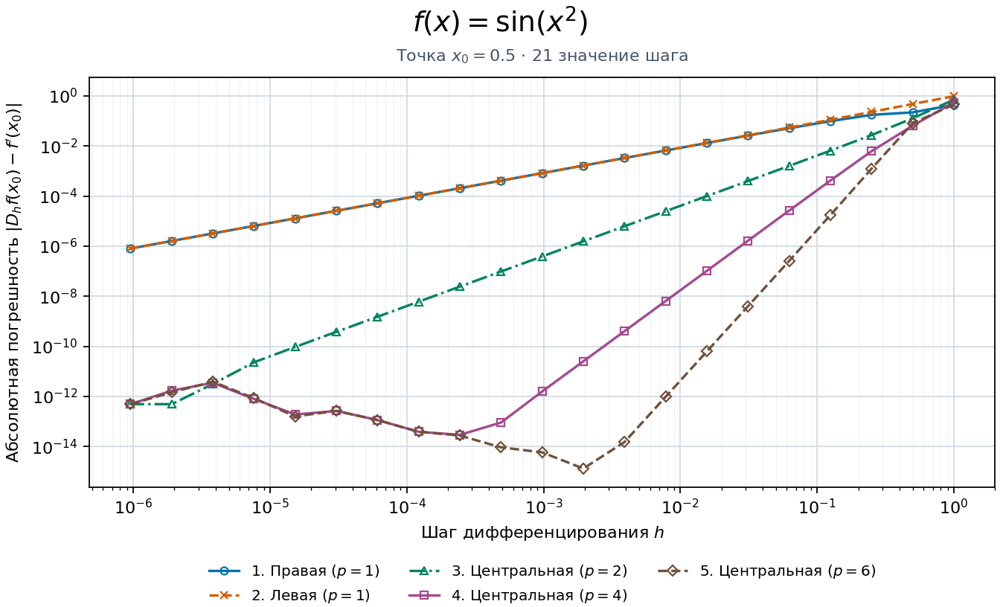
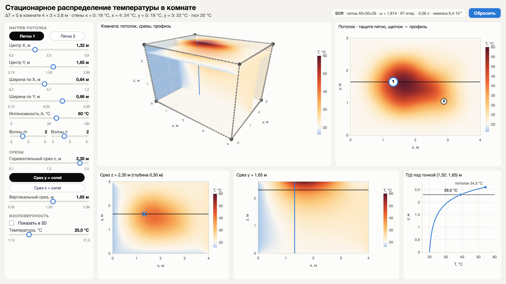

# Вычислительная математика

Практические работы по численным методам.

## Задания

| [1. Численное дифференцирование](numerical-differentiation/) | [2. Решение СЛАУ](systems%20of%20linear%20algebraic%20equations/) |
| :--- | :--- |
| Сравнить погрешность пяти разностных формул для пяти функций на сетке из 21 шага. Построить пять графиков в масштабе log–log. | Решить задачу II.10.5, вариант «м», двумя прямыми и семью итерационными методами. Построить график сходимости по невязке. |
|  |  |

### [3. Нелинейные уравнения](nonlinear%20equations/)

Решить два уравнения из IV.12.3 и по одной системе из IV.12.4 и IV.12.6. Сравнить половинное деление, простую итерацию, метод Ньютона и модифицированный метод Ньютона.

## Проекты

### [PDE-Solver — тепло от потолка](PDE-Solver/)

Как рисунок температуры на потолке меняется с глубиной? Стационарное поле в комнате 4 × 3 × 2,6 м: уравнение Лапласа, семиточечная схема, сравнение методов Якоби, Зейделя и верхней релаксации. Интерактивный стенд на Dash, [отчёт](PDE-Solver/README.md) и [презентация](PDE-Solver/presentation/PDE-Solver.pdf).

