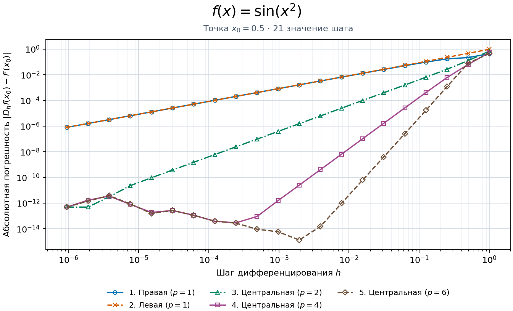

# Вычислительная математика

Практические работы по численным методам.

## Задания

| [1. Численное дифференцирование](numerical-differentiation/) | [2. Решение СЛАУ](systems%20of%20linear%20algebraic%20equations/) |
| :--- | :--- |
| Сравнить погрешность пяти разностных формул для пяти функций на сетке из 21 шага. Построить пять графиков в масштабе log–log. | Решить задачу II.10.5, вариант «м», двумя прямыми и семью итерационными методами. Построить график сходимости по невязке. |
|  |  |

## Следующие задания

<!-- Здесь будут ссылки на следующие задания. -->
