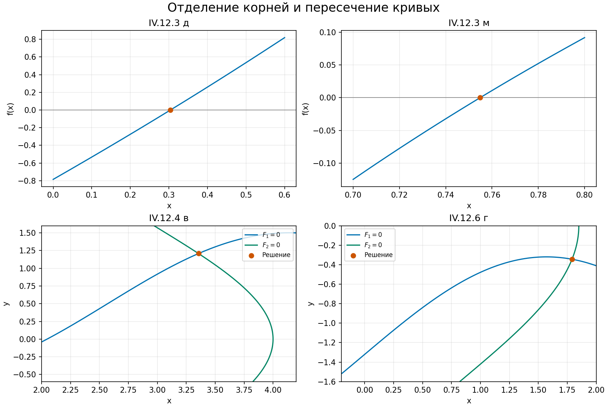
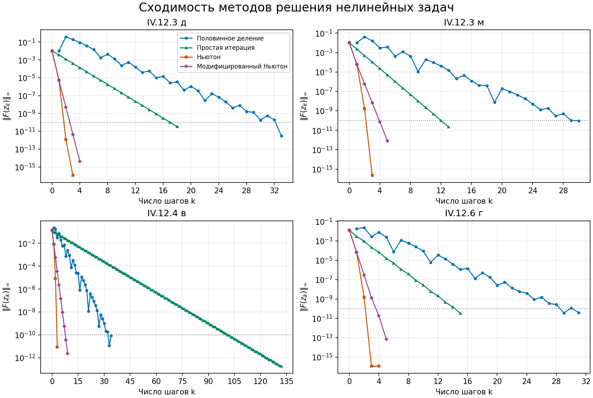

# Нелинейные уравнения

[Все задания](../README.md)

Лабораторная работа № 3. Выбраны уравнения IV.12.3 «д» и «м», система IV.12.4 «в» и система IV.12.6 «г» из практикума Аристовой, Завьяловой и Лобанова. Для каждой задачи сравниваются половинное деление, простая итерация, метод Ньютона и модифицированный метод Ньютона.

## Уравнения и отделение корней

**IV.12.3 «д»**

$$f(x)=\arctan(x-1)+2x=0.$$

Производная $f'(x)=2+1/(1+(x-1)^2)>0$. При $x\to\pm\infty$ функция стремится к $\pm\infty$, поэтому действительный корень единственный. Он отделён на $[0,0.6]$, где значения функции имеют разные знаки. Для простой итерации берётся $\varphi(x)=-\arctan(x-1)/2$. Она переводит этот отрезок в себя и удовлетворяет $|\varphi'(x)|\leq 0.5$. Начальное приближение $x_0=0.3$.

**IV.12.3 «м»**

$$\sqrt{x+1}=\frac1x,\qquad f(x)=\sqrt{x+1}-\frac1x.$$

Область определения $x\geq-1$, $x\ne0$. При $x<0$ правая часть отрицательна, а левая неотрицательна, поэтому корни могут быть только положительными. На $(0,+\infty)$ функция строго возрастает от $-\infty$ до $+\infty$. Единственный корень отделён на $[0.7,0.8]$. Преобразование $\varphi(x)=1/\sqrt{x+1}$ переводит отрезок в себя, причём $|\varphi'(x)|\leq1/(2\cdot1.7^{3/2})<0.23$. Начальное приближение $x_0=0.75$.

## Системы и полнота поиска решений

**IV.12.4 «в»**

$$
F(x,y)=\begin{pmatrix}\cos(x-1)+y-0.5\\x-\cos y-3\end{pmatrix}=0,
\qquad
J(x,y)=\begin{pmatrix}-\sin(x-1)&1\\1&\sin y\end{pmatrix}.
$$

Из второго уравнения $2\leq x\leq4$, а из первого $-0.5\leq y\leq1.5$. На этом отрезке $\cos y>0$, значит $x>3$. Уточнение по первому уравнению даёт $0.9<y<1.5$. Все решения находятся в прямоугольнике $D=[3,4]\times[0.9,1.5]$.

Для простой итерации используется отображение $\Phi(x,y)=(3+\cos y,\;0.5-\cos(x-1))^T$. Оно переводит $D$ в себя. В норме $\|\cdot\|_\infty$ норма его производной не превышает $\max(\sin1.5,\sin2)<0.998$. По теореме о сжимающем отображении решение существует и единственно. Начальное приближение $(3.5,1.2)$.

Для половинного деления исключается $y=0.5-\cos(x-1)$ и решается уравнение $g(x)=x-3-\cos(0.5-\cos(x-1))=0$ на $[3,4]$. Координата $y$ восстанавливается после каждого деления. Поскольку $|dy/dx|\leq1$, оценка погрешности координаты $x$ также ограничивает погрешность восстановленного $y$.

**IV.12.6 «г»**

$$
F(x,y)=\begin{pmatrix}\sin x-y-1.32\\\cos y-x+0.85\end{pmatrix}=0,
\qquad
J(x,y)=\begin{pmatrix}\cos x&-1\\-1&-\sin y\end{pmatrix}.
$$

Из уравнений получаются начальные границы $x\in[-0.15,1.85]$, $y\in[-1.47,-0.32]$. Подстановка границ во второе уравнение даёт $x>0.95$, затем первое даёт $y>-0.51$, а второе — $x>1.72$. Ещё одна подстановка даёт $y>-0.36$. Следовательно, все решения лежат в $D=[1.7,1.85]\times[-0.37,-0.32]$.

Отображение $\Phi(x,y)=(0.85+\cos y,\;\sin x-1.32)^T$ переводит этот прямоугольник в себя. Норма его производной ограничена $\max(\sin0.37,|\cos1.85|)<0.362$. Поэтому в $D$ существует ровно одно решение, и оно является единственной точкой пересечения исходных кривых. Начальное приближение $(1.78,-0.34)$.

Для половинного деления используется $g(x)=x-0.85-\cos(\sin x-1.32)$ на $[1.7,1.85]$, затем восстанавливается $y=\sin x-1.32$. Здесь также $|dy/dx|\leq1$.



## Алгоритмы и остановка

- Половинное деление сохраняет отрезок со сменой знака. Остановка выполняется, когда половина его длины и невязка исходной задачи не превышают $10^{-10}$. При точном машинном нуле деление завершается сразу.
- Простая итерация имеет вид $z_{k+1}=\Phi(z_k)$. Проверяются невязка и апостериорная оценка $q\|z_{k+1}-z_k\|_\infty/(1-q)\leq10^{-10}$. Используются верхние границы $q$, указанные выше.
- Метод Ньютона решает линейную систему $J(z_k)\Delta z_k=-F(z_k)$ и обновляет $z_{k+1}=z_k+\Delta z_k$.
- Модифицированный метод Ньютона сохраняет производную или матрицу Якоби в начальной точке, то есть решает $J(z_0)\Delta z_k=-F(z_k)$.

В обоих методах Ньютона проверяются одновременно невязка и норма приращения, порог равен $10^{-10}$. Предельное число шагов равно 2000. Для скалярных уравнений используется абсолютная величина, для систем — максимум модулей компонент. Итоговая точность дополнительно проверена сопоставлением с половинным делением. Она превышает требуемые в практикуме $10^{-3}$ для IV.12.4 и $10^{-5}$ для IV.12.6.

## Результаты

Координаты в таблице округлены до десяти знаков после запятой. Невязки вычислены до округления.

| Задача | Метод | Решение | Шагов | Невязка |
| --- | --- | --- | ---: | ---: |
| IV.12.3 д | Половинное деление | 0.3040135966 | 33 | `3.04e-12` |
| | Простая итерация | 0.3040135966 | 18 | `3.34e-11` |
| | Ньютон | 0.3040135966 | 3 | `1.11e-16` |
| | Модифицированный Ньютон | 0.3040135966 | 4 | `4.33e-15` |
| IV.12.3 м | Половинное деление | 0.7548776663 | 30 | `9.42e-11` |
| | Простая итерация | 0.7548776663 | 13 | `2.20e-11` |
| | Ньютон | 0.7548776662 | 4 | `0` |
| | Модифицированный Ньютон | 0.7548776662 | 5 | `7.88e-13` |
| IV.12.4 в | Половинное деление | (3.3559117389, 1.2069068176) | 34 | `8.57e-11` |
| | Простая итерация | (3.3559117388, 1.2069068175) | 132 | `1.77e-13` |
| | Ньютон | (3.3559117388, 1.2069068175) | 4 | `0` |
| | Модифицированный Ньютон | (3.3559117388, 1.2069068175) | 9 | `2.28e-12` |
| IV.12.6 г | Половинное деление | (1.7913386099, −0.3442210364) | 31 | `3.93e-11` |
| | Простая итерация | (1.7913386099, −0.3442210364) | 15 | `3.26e-11` |
| | Ньютон | (1.7913386100, −0.3442210364) | 4 | `1.11e-16` |
| | Модифицированный Ньютон | (1.7913386100, −0.3442210364) | 5 | `6.99e-14` |



Вертикальная ось логарифмическая. Для итерационных методов точка $k=0$ соответствует начальному приближению, для половинного деления первая точка соответствует первому делению. Точный машинный ноль пропускается на логарифмической оси. Число шагов отражает разные операции — деление отрезка, применение отображения или решение линейной системы.

Во всех четырёх задачах метод Ньютона потребовал 3–4 шага. При фиксированном Якобиане понадобилось 4–9 шагов. Простая итерация для IV.12.4 «в» потребовала 132 шага, поскольку использована консервативная оценка сжатия $q=0.998$. Для IV.12.6 «г» граница $q=0.362$ дала существенно более быструю сходимость. Невязка половинного деления может колебаться между соседними шагами, при этом длина отделяющего отрезка каждый раз уменьшается вдвое.

## Запуск

Из каталога `nonlinear equations` в Python 3.10 или новее выполните

```sh
python -m pip install -r requirements.txt
python solve.py
```

Программа выводит результаты всех 16 расчётов и сохраняет два рисунка в `figures`. Команда `python solve.py --show` дополнительно открывает рисунки в окнах. Исходные уравнения, производные, отображения итераций, интервалы и начальные приближения заданы в функции `problems()` файла `solve.py`.

## Литература

1. Аристова Е. Н., Завьялова Н. А., Лобанов А. И. *Практические занятия по вычислительной математике в МФТИ*. Часть 1. МФТИ, 2021. IV.12.3, с. 106, IV.12.4 и IV.12.6, с. 107.
2. *Численные методы решения нелинейных уравнений*. Предоставленный материал 3.1.1, разделы о простой итерации и методе Ньютона.
3. Арушанян И. О. *Численные алгоритмы решения нелинейных уравнений*. МГУ, 2018. Разделы 1–3 о методах, сходимости и практических критериях точности.
