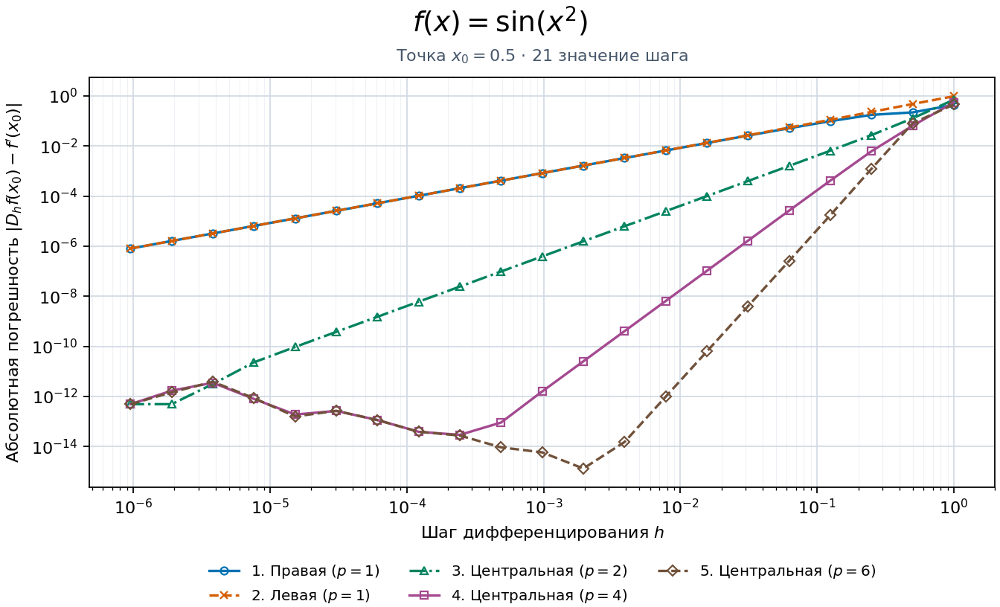
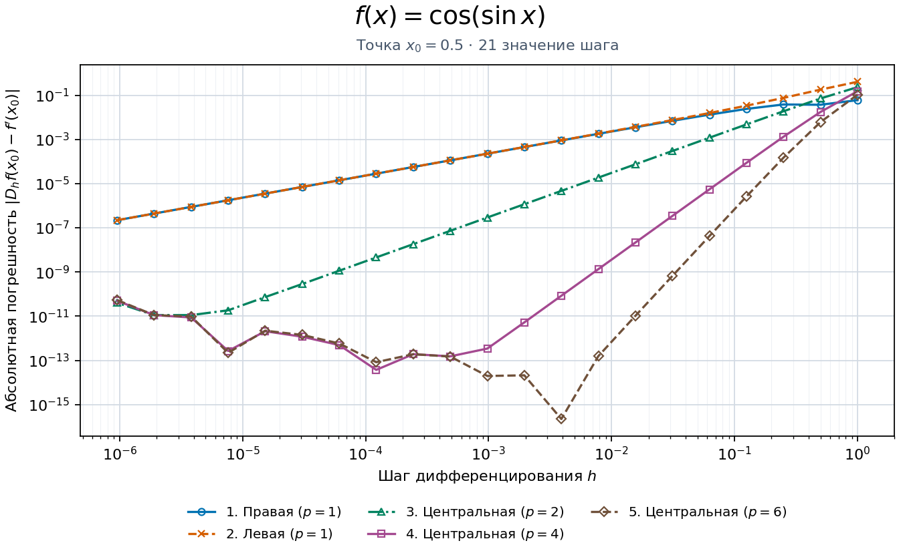
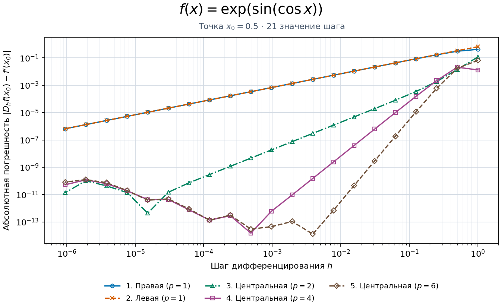
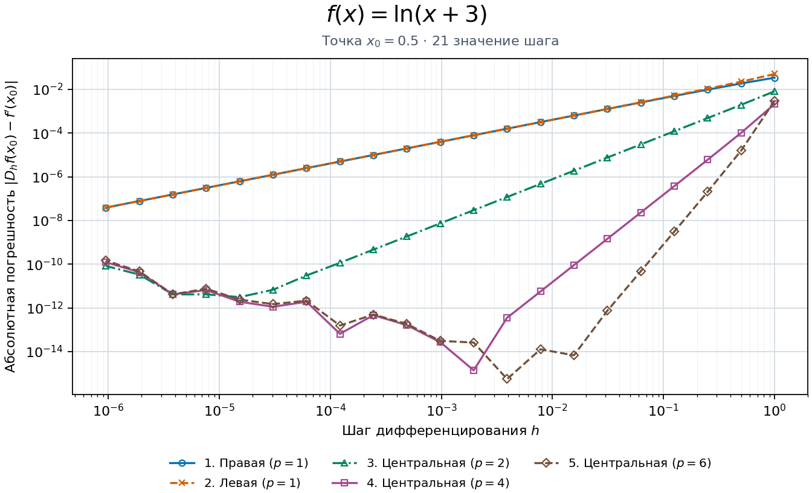
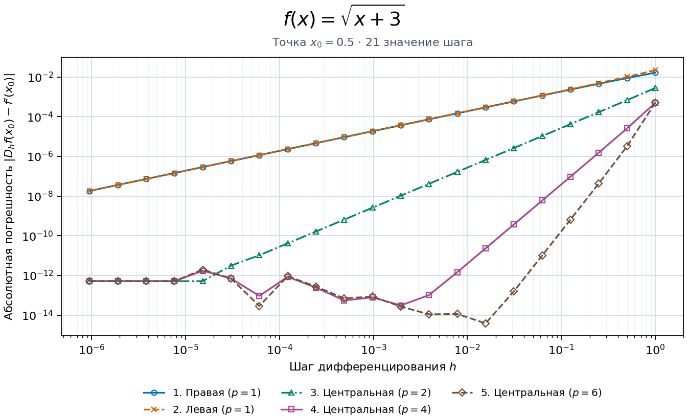

# Численное дифференцирование

Для пяти функций сравнивается абсолютная погрешность пяти конечно-разностных приближений первой производной. Шаги заданы формулой $h_n=2/2^n$, где $n=1,\ldots,21$. Они меняются от $1$ до $2^{-20}$.

Вычисления проводятся в точке $x_0=0.5$. При самом большом шаге крайний левый узел равен $x_0-3h=-2.5$, поэтому все узлы входят в область определения логарифма и квадратного корня.

## Разностные формулы

Обозначим центральную разность через $C(s)=[f(x_0+s)-f(x_0-s)]/(2s)$.

| № | Приближение $D_h f(x_0)$ | Порядок погрешности аппроксимации |
| --- | --- | --- |
| 1 | $\dfrac{f(x_0+h)-f(x_0)}{h}$ | $O(h)$ |
| 2 | $\dfrac{f(x_0)-f(x_0-h)}{h}$ | $O(h)$ |
| 3 | $C(h)$ | $O(h^2)$ |
| 4 | $\dfrac{4}{3}C(h)-\dfrac{1}{3}C(2h)$ | $O(h^4)$ |
| 5 | $\dfrac{3}{2}C(h)-\dfrac{3}{5}C(2h)+\dfrac{1}{10}C(3h)$ | $O(h^6)$ |

В четвёртой формуле коэффициенты сокращают член порядка $h^2$ в разложении центральной разности, а в пятой сокращаются члены порядков $h^2$ и $h^4$.

## Аналитические производные

| $f(x)$ | $f'(x)$ |
| --- | --- |
| $\sin(x^2)$ | $2x\cos(x^2)$ |
| $\cos(\sin x)$ | $-\sin(\sin x)\cos x$ |
| $\exp(\sin(\cos x))$ | $-\exp(\sin(\cos x))\cos(\cos x)\sin x$ |
| $\ln(x+3)$ | $\dfrac{1}{x+3}$ |
| $\sqrt{x+3}$ | $\dfrac{1}{2\sqrt{x+3}}$ |

Для каждой пары «формула и шаг» вычисляется погрешность $\lvert D_h f(x_0)-f'(x_0)\rvert$. На каждом рисунке показаны пять кривых, обе оси логарифмические. Если вычисленная погрешность равна нулю, соответствующая точка пропускается на логарифмической оси.

## Графики











Пока преобладает погрешность аппроксимации, уменьшение шага снижает погрешность, причём у формул высокого порядка спад круче. При малых шагах вычитаются близкие значения функции, и деление их разности на $h$ усиливает влияние округления. На графиках центральных формул высокого порядка в этой области погрешность перестаёт убывать монотонно.

## Запуск

Из каталога `numerical-differentiation` выполните команды в Python 3.10 или новее.

```sh
python -m pip install -r requirements.txt
python differentiate.py
```

Программа сохраняет пять PNG в каталоге `figures` и показывает каждый рисунок в отдельном окне. Для сохранения без открытия окон выполните `python differentiate.py --no-show`.
