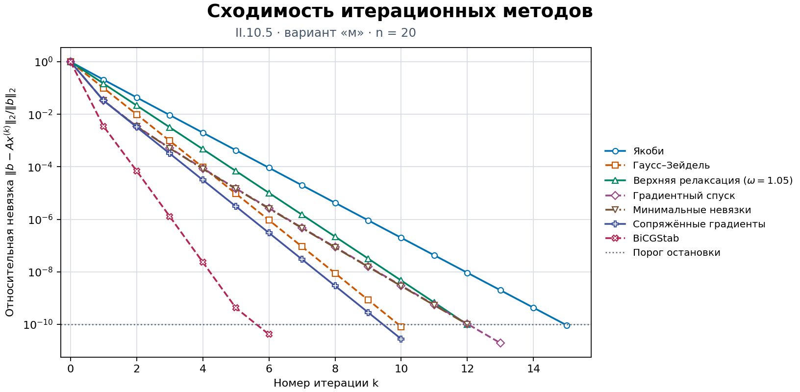

# Численные методы решения СЛАУ

Задание II.10.5, вариант **м**, из практикума «Практические занятия по вычислительной математике в МФТИ». Сравниваются два прямых и семь итерационных методов решения системы $Ax=b$.

## Исходная система

Порядок системы $n=20$. Правая часть $b_i=i$ при $i=1,\ldots,20$. Матрица пятидиагональная:

$$
A_{ij}=\begin{cases}
10, & i=j,\\
1, & \lvert i-j\rvert=1,\\
0.1, & \lvert i-j\rvert=2,\\
0, & \text{в остальных случаях}.
\end{cases}
$$

Матрица симметрична, а сумма модулей внедиагональных элементов в каждой строке не превышает $2.2$. По теореме Гершгорина её собственные значения лежат в $[7.8,12.2]$. Положительная определённость позволяет применить градиентный спуск и сопряжённые градиенты. Строгое диагональное преобладание даёт сходимость методов Якоби и Гаусса–Зейделя. Для SOR при такой матрице допустимо $0<\omega<2$, в расчёте взято $\omega=1.05$.

## Методы и критерий остановки

Все методы реализованы в [`methods.py`](methods.py). Метод Гаусса завершается обратной подстановкой. При LU-разложении используются прямая и обратная подстановки.

| Метод | Вычислительная схема |
| --- | --- |
| Гаусс с выбором главного элемента | На каждом шаге выбирается наибольший по модулю элемент в активной части столбца. Его строка ставится на место ведущей, затем исключается текущая неизвестная. |
| LU-разложение | По схеме Дулиттла строится $A=LU$ с единичной диагональю $L$. Далее решаются $Ly=b$ и $Ux=y$. |
| Якоби | Все компоненты нового приближения вычисляются по значениям предыдущей итерации. |
| Гаусс–Зейдель | При обновлении компоненты сразу используются уже вычисленные компоненты той же итерации. |
| Последовательная верхняя релаксация (SOR) | Если $z_i$ — обновление по формуле Зейделя, то новая компонента равна $(1-\omega)x_i+\omega z_i$. |
| Градиентный спуск | Для $r=b-Ax$ берётся $x_{\text{нов}}=x+\alpha r$, где $\alpha=(r^Tr)/(r^TAr)$. Шаг минимизирует квадратичную функцию $x^TAx/2-b^Tx$ вдоль $r$. |
| Минимальные невязки | При том же направлении $r$ шаг $\alpha=((Ar)^Tr)/((Ar)^TAr)$ минимизирует евклидову норму новой невязки. |
| Сопряжённые градиенты (CG) | Приближение обновляется по $A$-сопряжённым направлениям. Следующее направление строится из новой невязки и предыдущего направления. |
| BiCGStab | После шага вдоль направления бисопряжённого процесса промежуточная невязка дополнительно уменьшается одномерной минимизацией. |

Для CG начальное направление равно $p_0=r_0$. На шаге $k$ вычисляются $\alpha_k=(r_k^Tr_k)/(p_k^TAp_k)$, $x_{k+1}=x_k+\alpha_kp_k$ и $r_{k+1}=r_k-\alpha_kAp_k$. Следующее направление равно $p_{k+1}=r_{k+1}+\beta_kp_k$, где $\beta_k=(r_{k+1}^Tr_{k+1})/(r_k^Tr_k)$.

В BiCGStab вектор $\hat r=r_0$ фиксирован, а начальное направление равно $p_0=r_0$. Вычисляются $v_k=Ap_k$, $\rho_k=\hat r^Tr_k$ и $\alpha_k=\rho_k/(\hat r^Tv_k)$. Затем $s_k=r_k-\alpha_kv_k$ и $t_k=As_k$. Коэффициент $\omega_k=(t_k^Ts_k)/(t_k^Tt_k)$ минимизирует норму $s_k-\omega_kt_k$. После этого $x_{k+1}=x_k+\alpha_kp_k+\omega_ks_k$ и $r_{k+1}=s_k-\omega_kt_k$. Направление обновляется по формуле $p_{k+1}=r_{k+1}+\beta_k(p_k-\omega_kv_k)$, где $\beta_k=(\rho_{k+1}/\rho_k)(\alpha_k/\omega_k)$.

Во всех итерационных методах $x^{(0)}=0$. Для графика и критерия остановки невязка заново вычисляется по формуле $r^{(k)}=b-Ax^{(k)}$. Итерации останавливаются при $\lVert r^{(k)}\rVert_2/s\leq 10^{-10}$, где $s=\lVert b\rVert_2$ при $b\ne0$ и $s=1$ при $b=0$. Предельное число итераций по умолчанию равно 2000. Внутри итерационных методов правая часть масштабируется степенью двойки, а полученный вектор приводится к масштабу исходной системы.

## Результаты

Вектор решения, полученный методом Гаусса с частичным выбором главного элемента, округлён до десяти знаков после запятой. Невязки в таблице рассчитаны по значениям до округления.

```text
(0.0811392606, 0.1640172216, 0.2459017230, 0.3278680078, 0.4098361492,
 0.4918032789, 0.5737704909, 0.6557377050, 0.7377049180, 0.8196721311,
 0.9016393445, 0.9836065555, 1.0655737692, 1.1475411781, 1.2295064016,
 1.3114739231, 1.3936350587, 1.4736519090, 1.5557294045, 1.8296905405)
```

| Метод | Итераций | Норма конечной невязки | Относительная невязка |
| --- | ---: | ---: | ---: |
| Гаусс с выбором главного элемента | — | `4.4851e-15` | `8.3720e-17` |
| LU-разложение | — | `4.4686e-15` | `8.3412e-17` |
| Якоби | 15 | `4.9760e-09` | `9.2885e-11` |
| Гаусс–Зейдель | 10 | `4.3781e-09` | `8.1724e-11` |
| SOR, $\omega=1.05$ | 12 | `5.2460e-09` | `9.7924e-11` |
| Градиентный спуск | 13 | `1.0353e-09` | `1.9326e-11` |
| Минимальные невязки | 12 | `5.3316e-09` | `9.9521e-11` |
| Сопряжённые градиенты | 10 | `1.4801e-09` | `2.7628e-11` |
| BiCGStab | 6 | `2.2162e-09` | `4.1368e-11` |



На графике вертикальная ось логарифмическая, горизонтальная ось показывает номер итерации. Пунктирная горизонталь отмечает порог остановки. Все семь методов достигли заданной точности. BiCGStab потребовалось меньше всего итераций (6), при этом один его шаг может включать два умножения на матрицу внутри алгоритма. При выбранном $\omega=1.05$ SOR потребовалось 12 итераций против 10 у метода Гаусса–Зейделя. Кривые градиентного спуска и минимальных невязок близки. Оба метода делают шаг вдоль своей текущей невязки, выбирая длину шага по разным критериям.

Для сравнения были проверены несколько значений параметра релаксации при том же начальном приближении и пороге остановки. Значение $\omega=1$ соответствует методу Гаусса–Зейделя.

| $\omega$ | 1 | 1.001 | 1.01 | 1.05 | 1.1 | 1.2 |
| --- | ---: | ---: | ---: | ---: | ---: | ---: |
| Итераций | 10 | 10 | 11 | 12 | 15 | 19 |

На проверенной сетке верхняя релаксация не ускорила решение этой системы по числу итераций. Значение $\omega=1.05$ оставлено на общем графике как пример работы метода.

## Запуск

Из каталога проекта в Python 3.10 или новее:

```sh
python -m pip install -r requirements.txt
python solve.py
```

Программа выводит векторы решений или последние приближения по каждому методу, нормы невязок и число итераций. График для параметров из отчёта сохраняется в `convergence.png`, а расчёт с изменёнными параметрами — в `convergence-experiment.png`. Ключ `--show` дополнительно открывает рисунок в окне.

Для другой системы сохраните квадратную матрицу `A` и вектор `b` в JSON. Пример `system.json`:

```json
{
  "A": [[4, 1], [1, 3]],
  "b": [1, 2]
}
```

```sh
python solve.py --system system.json --tol 1e-10 --max-iterations 2000 --omega 1.05
```

Для пользовательской системы график записывается в `convergence-custom.png`. Другой путь можно указать через `--output`. Если условия конкретного метода нарушены, возникает вычислительный сбой или исчерпан лимит итераций, программа выводит соответствующий статус. На логарифмической оси отображаются положительные значения невязки.

## Литература

1. Аристова Е. Н., Завьялова Н. А., Лобанов А. И. *Практические занятия по вычислительной математике в МФТИ*. Ч. 1. МФТИ, 2021. Задача II.10.5, вариант м, с. 69.
2. Куксенко С. П., Газизов Т. Р. *Итерационные методы решения системы линейных алгебраических уравнений с плотной матрицей*. Томск, 2007. Разделы 2 и 3.
3. Ахунов Р. Р., Куксенко С. П., Газизов Т. Р., Орлов П. Е. *Многократное решение систем линейных алгебраических уравнений итерационными методами с предобусловливанием в задачах электромагнитной совместимости*. ТУСУР, 2015. Раздел 1.
4. Пузикова В. В. *Решение систем линейных алгебраических уравнений методом BiCGStab с предобусловливанием*. Вестник МГТУ им. Н. Э. Баумана, 2011. Алгоритм (1), с. 124.
